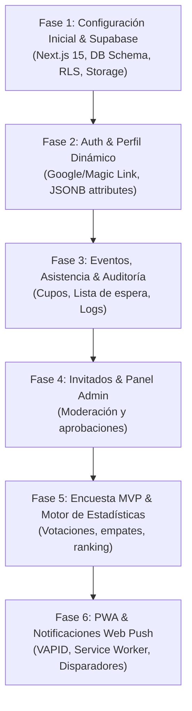

# Especificación de Arquitectura y Plan de Implementación: PWA Club Deportivo

Documento de especificación funcional y técnica tras la entrevista de alineación de diseño (`/grill-me`).

---

## 1. Resumen Ejecutivo y Stack Tecnológico

| Componente | Tecnología | Justificación |
| :--- | :--- | :--- |
| **Frontend Framework** | **Next.js 15 (App Router, TypeScript)** | Soporte nativo para Server Components, Server Actions, API routes y optimizaciones de rendimiento mobile. |
| **UI & Styling** | **Tailwind CSS + Lucide Icons** | Enfoque *mobile-first* utilitario, ligero, enfocado 100% en funcionalidad inicial sin sobrecarga de diseño. |
| **Backend & Base de Datos** | **Supabase (PostgreSQL 15+)** | Capa gratuita generosa (50.000 MAU, 500MB DB), autenticación lista para usar, Row Level Security (RLS) y Storage para avatares. |
| **Autenticación** | **Supabase Auth** | Google OAuth + Magic Link / Email OTP (acceso sin contraseñas en smartphone). |
| **PWA & Notificaciones** | **Serwist (Service Worker) + Web Push (VAPID)** | Instalable en iOS (Safari 16.4+) y Android (Chrome), con notificaciones push en segundo plano sin dependencias de tiendas de apps. |

---

## 2. Modelo de Datos (PostgreSQL + JSONB Mutable)

```mermaid
erDiagram
    profiles ||--o{ event_attendees : "confirma"
    profiles ||--o{ event_attendance_logs : "registra cambios"
    profiles ||--o{ mvp_votes : "vota / recibe"
    profiles ||--o{ user_stats : "acumula métricas"
    profiles ||--o{ push_subscriptions : "dispositivos"
    events ||--o{ event_attendees : "participantes"
    events ||--o{ event_attendance_logs : "historial"
    events ||--o{ mvp_votes : "votacion MVP"
    events ||--o{ event_guests : "invitados"
    profiles ||--o{ event_guests : "invita"

    profiles {
        uuid id PK
        string full_name
        string email
        string phone
        string avatar_url
        date birth_date
        string system_role "admin | member"
        string sports_role "jugador | hincha | ambos"
        jsonb custom_attributes "Estructura mutable (posicion, camiseta, etc.)"
        timestamp created_at
    }

    profile_field_definitions {
        uuid id PK
        string field_key
        string label
        string field_type "text | number | select | boolean"
        jsonb options "Opciones para select"
        boolean is_required
        int display_order
    }

    events {
        uuid id PK
        string title
        string description
        string event_type "partido | entrenamiento | torneo | asado | otro"
        timestamp start_time
        timestamp end_time
        string location
        int max_capacity "null si no tiene cupo"
        string status "convocado | en_curso | finalizado | cancelado"
        boolean mvp_voting_open
        timestamp mvp_voting_deadline
        uuid created_by FK
    }

    event_attendees {
        uuid id PK
        uuid event_id FK
        uuid user_id FK
        string status "confirmado | lista_espera | cancelado"
        timestamp registered_at
    }

    event_guests {
        uuid id PK
        uuid event_id FK
        uuid invited_by_user_id FK
        string guest_name
        string guest_contact
        string status "pendiente_aprobacion | aprobado | rechazado"
        uuid reviewed_by FK
        timestamp reviewed_at
    }

    event_attendance_logs {
        uuid id PK
        uuid event_id FK
        uuid user_id FK
        uuid actor_id FK "Quien realizo la accion (usuario o admin)"
        string action "confirmo | bajo | entro_espera | subio_espera | solicito_invitado | invitado_aprobado | invitado_rechazado"
        string reason "Motivo opcional de baja"
        timestamp created_at
    }

    mvp_votes {
        uuid id PK
        uuid event_id FK
        uuid voter_id FK
        uuid voted_player_id FK
        timestamp created_at
    }

    user_stats {
        uuid id PK
        uuid user_id FK
        int matches_played
        int mvp_count
        int mvp_votes_received
        int social_events_attended
        jsonb mutable_stats "matches_won, matches_lost, matches_tied, goals, etc."
        timestamp updated_at
    }

    push_subscriptions {
        uuid id PK
        uuid user_id FK
        text endpoint
        text keys_p256dh
        text keys_auth
        timestamp created_at
    }
```

---

## 3. Flujos de Trabajo Clave

### A. Registro y Perfil Dinámico
1. Login con Google o enlace mágico al correo.
2. Formulario de perfil con datos base obligatorios (nombre, foto, fecha de nacimiento, rol deportivo: jugador/hincha/ambos).
3. Render dinámico de campos adicionales definidos en `profile_field_definitions` guardados directamente en `profiles.custom_attributes (JSONB)`.

### B. Gestión de Eventos y Lista de Espera Automática
1. El admin publica un evento (ej: Partido de Fútbol 7, cupo 14).
2. Los usuarios confirman asistencia.
3. Si se llenan los 14 cupos, los siguientes entran automáticamente en estado `lista_espera`.
4. Si un jugador confirmado se baja:
   - Se registra en `event_attendance_logs`.
   - El primer usuario en `lista_espera` sube a `confirmado`.
   - Se dispara notificación Web Push al usuario promovido.

### C. Solicitud y Aprobación de Invitados
1. Un usuario solicita sumar un invitado (`guest_name`, `guest_contact`).
2. El invitado queda en `event_guests` con estado `pendiente_aprobacion` (no consume cupo aún).
3. Los administradores reciben aviso o ven una pestaña de "Aprobaciones pendientes".
4. Al aprobar:
   - Si hay cupo disponible, pasa a `aprobado` y suma al evento.
   - Si no hay cupo, se notifica o se suma a la lista de espera de invitados.
   - Se notifica por push al usuario que hizo la invitación.

### D. Cierre de Partido, Votación MVP y Estadísticas
1. Al terminar el partido, el admin presiona **"Finalizar Partido"** y valida la lista de presentes reales.
2. Se activa la encuesta de MVP con una ventana de 24 a 48 horas:
   - Solo pueden votar los asistentes reales que jugaron.
   - El autovoto está deshabilitado.
   - Los votos son anónimos durante la ventana abierta.
3. Al vencer el plazo o cerrar la votación:
   - Se calcula el jugador con más votos (en caso de empate se comparte el galardón).
   - Se actualiza la tabla `user_stats` incrementando `matches_played`, `mvp_count` y los campos de `mutable_stats` (victorias/derrotas si se cargó el resultado del encuentro).
   - Los resultados se muestran públicamente en el resumen del evento y en la tabla de líderes del club.

### E. PWA y Web Push Notifications
1. Manifest PWA (`manifest.json`) configurado para pantalla completa y experiencia standalone.
2. Banner de instalación suave ("Agregar a pantalla de inicio") para iOS y Android.
3. Suscripción a Web Push vía Service Worker con almacenamiento en `push_subscriptions`.
4. Endpoint `/api/push/send` que envía notificaciones firmadas con VAPID.

---

## 4. Fases de Implementación Paso a Paso

1. **Fase 1: Proyecto Base y Base de Datos**: Inicializar Next.js 15 con Tailwind y TypeScript en `/Users/seba/CampApp`. Script de migración SQL para Supabase con tablas, índices y políticas RLS.
2. **Fase 2: Autenticación y Perfiles**: Integración de Supabase SSR (`@supabase/ssr`), página de login mobile, gestión de perfiles con upload de avatar a Supabase Storage y soporte para campos dinámicos `JSONB`.
3. **Fase 3: Módulo de Eventos y Lista de Espera**: CRUD de eventos, listado de próximos partidos/asados, botón de confirmación con 1-click, lógica de auto-promoción de lista de espera y tabla de auditoría `event_attendance_logs`.
4. **Fase 4: Módulo de Invitados y Moderación**: Formulario para sumar invitados y pantalla de moderación rápida para administradores.
5. **Fase 5: Sistema de Encuestas MVP y Estadísticas**: Flujo post-evento para votación de MVP, validación de autovoto, agregación en `user_stats` con métricas mutables y vista de tabla de líderes / leaderboard.
6. **Fase 6: PWA y Web Push**: Configuración de `manifest.json`, Service Worker con Serwist, generación de claves VAPID y triggers de notificación push.
