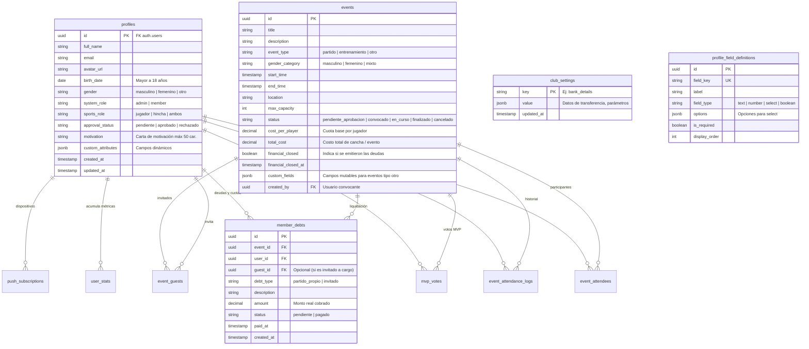

# 02. Base de Datos, Esquemas y RLS

Documentación técnica del modelo relacional, las políticas de Row Level Security (RLS) y las funciones atómicas almacenadas en PostgreSQL.

---

## 1. Esquema Relacional

El modelo combina integridad relacional estricta para relaciones clave y flexibilidad `JSONB` para atributos de negocio variables.

---

## 2. Catálogo de Tablas

### `profiles`
Extensión de `auth.users`. Almacena la identidad deportiva y de membresía del usuario.
- **`birth_date`**: Fecha de nacimiento. Restringida por validación a mayores de 18 años.
- **`gender`**: Identidad de género del socio (`masculino`, `femenino`, `otro`). Relevante para validar la inscripción a convocatorias por categoría.
- **`system_role`**: Controla privilegios de administración (`admin` o `member`).
- **`sports_role`**: Tipo de afiliación (`jugador`, `hincha`, `ambos`).
- **`approval_status`**: Estado de admisión en el club (`pendiente`, `aprobado`, `rechazado`). Controla el acceso global (gatekeeper). Un usuario rechazado puede reenviar su postulación, regresando a `pendiente`.
- **`motivation`**: Carta de motivación breve enviada por el postulante (máximo 50 caracteres).
- **`custom_attributes`**: Contenedor `JSONB` indexable que almacena los valores correspondientes a `profile_field_definitions` (ej: posición, dorsal, pie hábil).

### `profile_field_definitions`
Configuración administrable de campos de perfil adicionales. Permite agregar nuevos campos sin alterar el esquema SQL.

### `events`
Partidos, entrenamientos o eventos sociales.
- **`event_type`**: `partido`, `entrenamiento`, `otro`.
- **`gender_category`**: Categoría de género de la convocatoria (`masculino`, `femenino`, `mixto`).
- **`max_capacity`**: Cupo máximo permitido. Si es `NULL`, no tiene límite.
- **`status`**: `pendiente_aprobacion`, `convocado`, `en_curso`, `finalizado`, `cancelado`.
- **`cost_per_player`**: Monto base o ejecutado por jugador.
- **`total_cost`**: Costo global de la cancha o evento para prorrateo automático.
- **`financial_closed`**: Booleano que indica si el partido ya tuvo su liquidación financiera emitida.
- **`financial_closed_at`**: Timestamp de la emisión del cierre financiero.
- **`created_by`**: ID del usuario que convocó el evento (requiere aprobación si no es admin).
- **`custom_fields`**: Contenedor `JSONB` mutable para campos dinámicos en eventos de tipo "otro" (ej: cuota asado, lugar quincho, encargado de compras).
- **`mvp_voting_open`**: Bandera booleana para abrir o cerrar la ventana de votación de jugador del partido (exclusivo para `event_type = 'partido'`).

### `member_debts`
Control de deudas individuales por eventos deportivos o sociales.
- **`debt_type`**: `partido_propio` (asistencia del socio) o `invitado` (invitado a cargo del socio).
- **`amount`**: Monto real liquidado por el administrador tras el cierre.
- **`status`**: `pendiente` o `pagado`.
- **`paid_at`**: Timestamp en el que un administrador marcó la deuda como saldada.

### `club_settings`
Configuración centralizada en pares clave/valor `JSONB`. Almacena los datos bancarios del club (`key = 'bank_details'`) para transferencias y parámetros globales.

### `event_attendees`
Inscripciones de los socios.
- **`status`**: `confirmado`, `lista_espera`, `cancelado`.

### `event_guests`
Invitados externos propuestos por socios. Requieren aprobación de un administrador (`pendiente_aprobacion`, `aprobado`, `rechazado`).

### `event_attendance_logs`
Bitácora de auditoría inmutable que registra quién confirmó, quién se dio de baja, quién subió de lista de espera y los motivos opcionales.

### `mvp_votes`
Votos de jugador más valioso por evento.
- **Restricción**: Un voto por socio por evento. Prohibido el autovoto (`voter_id <> voted_player_id`).

### `user_stats`
Métricas consolidadas de rendimiento y asistencia por jugador.
- **`mutable_stats`**: Objeto `JSONB` con victorias, derrotas, empates, goles, etc.

### `push_subscriptions`
Endpoints y credenciales criptográficas de dispositivos móviles para Web Push vinculadas a cada cuenta de usuario (`user_id`).

### `in_app_notifications`
Buzón oficial de notificaciones dentro de la app para todos los socios. Registra `user_id`, `club_id` (aislamiento multi-club), `title`, `body`, `url`, `type` (`evento`, `finanzas`, `membresia`, `mvp`, `admin`, `recordatorio`, `sistema`), `is_read` y `created_at`. Publicado en Supabase Realtime para actualización instantánea de la campana.

---

## 3. Funciones Almacenadas Atómicas (RPCs)

Para evitar condiciones de carrera (*race conditions*) con múltiples usuarios confirmando simultáneamente:

1. **`join_event(p_event_id, p_user_id)`**:
   Calcula en una única transacción si la suma de confirmados e invitados aprobados supera `max_capacity`. Si hay cupo, asigna `confirmado`. Si está lleno, asigna `lista_espera`. Registra la auditoría en `event_attendance_logs`.

2. **`leave_event(p_event_id, p_user_id, p_actor_id, p_reason)`**:
   Cancela la asistencia del usuario. Si estaba confirmado, selecciona con bloqueo exclusivo (`FOR UPDATE SKIP LOCKED`) al primer integrante de la lista de espera por orden de registro (`registered_at ASC`), lo promueve a `confirmado`, registra el log y retorna su `user_id` para disparar la notificación Push.

3. **`close_event_finances(p_event_id, p_custom_debts)`**:
   Realiza la liquidación financiera manual del partido en una única transacción:
   - Procesa un arreglo de cargos personalizados (`userId`, `guestId`, `amount`, `description`).
   - Maneja exenciones ($0) eliminando cargos pendientes si fueron perdonados o becados.
   - Inserta o actualiza las deudas en `member_debts`.
   - Calcula el promedio real ejecutado y actualiza `events.cost_per_player` y marca `events.financial_closed = true`.

4. **`finalize_event_mvp(p_event_id)`**:
   Cierra la votación, computa el jugador o jugadores con mayor cantidad de votos (soporta empates compartidos), incrementa `mvp_count`, `mvp_votes_received` y `matches_played` en `user_stats`.

5. **`is_admin(user_id)`**:
   Función con atributo `SECURITY DEFINER` que consulta el rol del usuario sin disparar recursiones infinitas dentro de las políticas de RLS.

6. **RPCs de Notificaciones y Segmentación Multi-Club**:
   - `get_club_members_push_subscriptions(p_club_id, p_exclude_user_id)`: Obtiene credenciales de suscripciones push de miembros aprobados de un club específico.
   - `get_club_admins_push_subscriptions(p_club_id, p_exclude_user_id)`: Obtiene credenciales push exclusivas de administradores del club.
   - `create_in_app_notification(...)` y `create_bulk_in_app_notifications(...)`: Inserción segura `SECURITY DEFINER` de alertas en el buzón.
   - `mark_all_notifications_as_read(p_club_id)`: Marca en lote como leídas las alertas del socio activo.

---

## 4. Registro de Migraciones en Supabase

Las migraciones se ejecutan ordenadamente en el SQL Editor de Supabase:

1. **[`001_initial_schema.sql`](../../supabase/migrations/001_initial_schema.sql)**: Tablas base, triggers de auditoría, RPCs `join_event`, `leave_event`, `finalize_event_mvp` y RLS inicial.
2. **[`002_finances_and_realtime.sql`](../../supabase/migrations/002_finances_and_realtime.sql)**: Modelo de deudas en `member_debts`, soporte de invitados a cargo y publicaciones Realtime.
3. **[`003_event_approval_and_member_admission.sql`](../../supabase/migrations/003_event_approval_and_member_admission.sql)**: Admisión con `approval_status`, carta de motivación, RPC `close_event_finances` y políticas de eliminación.
4. **[`004_event_gender_category_and_profile_gender.sql`](../../supabase/migrations/004_event_gender_category_and_profile_gender.sql)**: Incorporación de `gender` en `profiles` y `gender_category` en `events`.
5. **[`004_multiclub_architecture.sql`](../../supabase/migrations/004_multiclub_architecture.sql)**: Multi-tenancy multi-club con `clubs`, `club_members`, dynamic fields y migración de datos.
6. **[`005_notifications_and_reminders.sql`](../../supabase/migrations/005_notifications_and_reminders.sql)**: Buzón `in_app_notifications`, RPCs de push segmentadas por club, banderas de recordatorio `reminder_24h_sent` y `reminder_mvp_sent`, y publicación Realtime.
