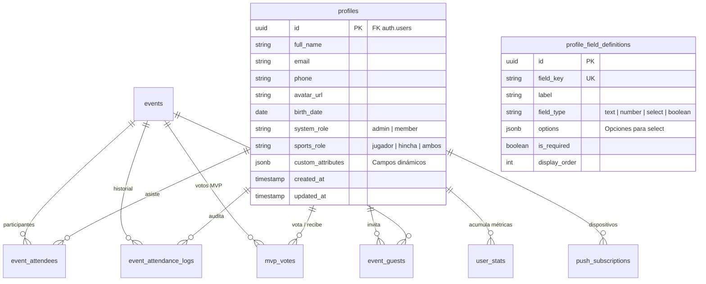

# 02. Base de Datos, Esquemas y RLS

Documentación técnica del modelo relacional, las políticas de Row Level Security (RLS) y las funciones atómicas almacenadas en PostgreSQL.

---

## 1. Esquema Relacional

El modelo combina integridad relacional estricta para relaciones clave y flexibilidad `JSONB` para atributos de negocio variables.

---

## 2. Catálogo de Tablas

### `profiles`
Extensión de `auth.users`. Almacena la identidad deportiva del usuario.
- **`system_role`**: Controla privilegios de administración (`admin` o `member`).
- **`sports_role`**: Tipo de afiliación (`jugador`, `hincha`, `ambos`).
- **`custom_attributes`**: Contenedor `JSONB` indexable que almacena los valores correspondientes a `profile_field_definitions` (ej: posición, dorsal, pierna hábil).

### `profile_field_definitions`
Configuración administrable de campos de perfil adicionales. Permite agregar nuevos campos sin alterar el esquema SQL.

### `events`
Partidos, entrenamientos o eventos sociales.
- **`max_capacity`**: Cupo máximo permitido. Si es `NULL`, no tiene límite.
- **`status`**: `convocado`, `en_curso`, `finalizado`, `cancelado`.
- **`mvp_voting_open`**: Bandera booleana para abrir o cerrar la ventana de votación de jugador del partido.

### `event_attendees`
Inscripciones de los socios.
- **`status`**: `confirmado`, `lista_espera`, `cancelado`.

### `event_guests`
Invitados externos propuestos por socios. Requieren aprobación de un administrador (`pendiente_aprobacion`, `aprobado`, `rechazado`).

### `event_attendance_logs`
Bitácora de auditoría inmutable que registra quién confirmó, quién se dio de baja, quién subió de lista de espera y los motivos opcionales.

### `mvp_votes`
Votos de jugador más valioso por evento.
- **Restricción**: Un voto por socio por evento. Prohibido el autovoto (`voter_id <> voted_player_id`).

### `user_stats`
Métricas consolidadas de rendimiento y asistencia por jugador.
- **`mutable_stats`**: Objeto `JSONB` con victorias, derrotas, empates, goles, etc.

### `push_subscriptions`
Endpoints y credenciales criptográficas de dispositivos móviles para Web Push.

---

## 3. Funciones Almacenadas Atómicas (RPCs)

Para evitar condiciones de carrera (*race conditions*) con múltiples usuarios confirmando simultáneamente:

1. **`join_event(p_event_id, p_user_id)`**:
   Calcula en una única transacción si la suma de confirmados e invitados aprobados supera `max_capacity`. Si hay cupo, asigna `confirmado`. Si está lleno, asigna `lista_espera`. Registra la auditoría en `event_attendance_logs`.

2. **`leave_event(p_event_id, p_user_id, p_actor_id, p_reason)`**:
   Cancela la asistencia del usuario. Si estaba confirmado, selecciona con bloqueo exclusivo (`FOR UPDATE SKIP LOCKED`) al primer integrante de la lista de espera por orden de registro (`registered_at ASC`), lo promueve a `confirmado`, registra el log y retorna su `user_id` para disparar la notificación Push.

3. **`finalize_event_mvp(p_event_id)`**:
   Cierra la votación, computa el jugador o jugadores con mayor cantidad de votos (soporta empates compartidos), incrementa `mvp_count`, `mvp_votes_received` y `matches_played` en `user_stats`.

4. **`is_admin(user_id)`**:
   Función con atributo `SECURITY DEFINER` que consulta el rol del usuario sin disparar recursiones infinitas dentro de las políticas de RLS.

---

## 4. Instrucción de Ejecución en Supabase

El script consolidado se encuentra en:
[`supabase/migrations/001_initial_schema.sql`](../../supabase/migrations/001_initial_schema.sql)

Para aplicarlo:
1. Abrir el panel de Supabase: **SQL Editor**.
2. Copiar y pegar el contenido completo del archivo.
3. Ejecutar (**Run**).
