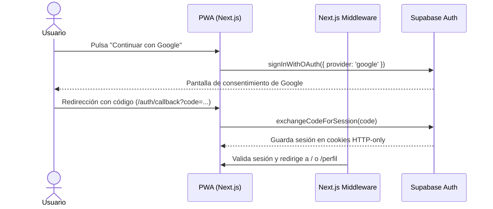

# 03. Autenticación y Perfil Dinámico

Guía de implementación de autenticación passwordless y el sistema dinámico de perfiles mutables.

---

## 1. Estrategia de Autenticación Mobile-First

En smartphones, recordar contraseñas o esperar correos de enlace mágico genera fricción y caídas en el registro. La plataforma utiliza autenticación federada directa:
- **Google OAuth Exclusivo**: Acceso instantáneo de 1-toque con la cuenta de Google vinculada al dispositivo móvil del socio. Se retiró la opción de enlace mágico para simplificar la interfaz y garantizar una experiencia uniforme.

---

## 2. Flujo de Autenticación con SSR



---

## 3. Flujo de Admisión y Gatekeeper (`PendingApprovalScreen`)

Para proteger la privacidad de las convocatorias y garantizar que solo socios admitidos participen de las actividades:

### 1. Estado de Admisión Inicial
Al registrarse un nuevo socio, el perfil se crea automáticamente con:
- `approval_status = 'pendiente'`
- `system_role = 'member'`

### 2. Bloqueo Global de Navegación (Gatekeeper)
- **Ruta Raíz (`/`)**: Si el usuario está autenticado pero su estado es `pendiente` o `rechazado`, el servidor intercepta el renderizado y retorna exclusivamente [`PendingApprovalScreen`](../../src/components/PendingApprovalScreen.tsx). No se cargan partidos, accesos ni métricas.
- **Barra de Navegación Móvil (`BottomNav`)**: En [`RootLayout`](../../src/app/layout.tsx), la barra inferior solo se monta si el usuario no tiene sesión o si su perfil está debidamente `aprobado`.
- **Rutas Protegidas**: Todas las páginas (`/eventos`, `/eventos/[id]`, `/eventos/nuevo`, `/finanzas`, `/miembros`, `/ranking`, `/perfil`, `/admin/invitados`) verifican el estado en la base de datos y redirigen a `/` si el socio no está aprobado.

### 3. Carta de Motivación y Re-postulación (Evitar Blacklist)
Dentro de la pantalla de espera, el postulante dispone de un formulario interactivo para comunicarse con los administradores:
- **Límite Estricto**: Máximo 50 caracteres con contador en tiempo real `(X/50)`.
- **Socio Pendiente**: Puede enviar o actualizar su carta de motivación.
- **Socio Rechazado**: No queda bloqueado permanentemente. La pantalla le notifica con badge *"Solicitud No Aprobada"* y le permite actualizar su mensaje y pulsar **"Reenviar Postulación al Club"**, lo cual restaura su estado a `pendiente` mediante [`submitMotivationAction`](../../src/app/miembros/actions.ts), permitiendo que los administradores reconsideren su ingreso.
- **Panel Administrativo**: Los administradores disponen de secciones separadas en `/miembros` para solicitudes pendientes y solicitudes rechazadas, con botones de *Aprobar*, *Reconsiderar* y *Eliminar*.

---

## 4. Manejo de Perfiles, Género y Regla de Edad (+18 años)

### Disparador de Creación de Perfil
Al registrarse un nuevo usuario en `auth.users`, el trigger SQL `handle_new_user` inserta automáticamente una fila en `public.profiles` con su nombre y correo, y una fila vacía en `public.user_stats`.

### Nuevos Atributos de Perfil
1. **Género (`gender`)**:
   - Opciones: `masculino` (👨), `femenino` (👩), `otro` (⚧).
   - Indicador contextual para el socio: *"Relevante para convocatorias y eventos por categoría (femenino, masculino o mixto)"*.
   - Requerido para inscribirse a partidos categorizados.
2. **Fecha de Nacimiento (`birth_date`) y Restricción de Mayoría de Edad**:
   - **Frontend**: El selector `<input type="date">` cuenta con la propiedad `max` calculada al día exacto de 18 años atrás, impidiendo seleccionar fechas menores a 18 años.
   - **Backend**: [`updateProfile`](../../src/app/auth/actions.ts) valida la diferencia de años y rechaza cualquier intento de registro menor de 18 años.

### Campos Dinámicos Adicionales
Los campos deportivos complementarios (posición en la cancha, pierna hábil, número de camiseta preferido) no requieren alterar tablas SQL.
1. Se consultan las definiciones en `public.profile_field_definitions`.
2. Se renderiza dinámicamente el control de entrada (`text`, `number`, `select`, `boolean`).
3. El formulario guarda el objeto consolidado en la columna `profiles.custom_attributes (JSONB)`:
   ```json
   {
     "posicion": "Mediocampista",
     "numero_camiseta": 10,
     "pie_habil": "Derecho"
   }
   ```

---

## 5. Almacenamiento y Compresión de Avatares (Supabase Storage)

Para evitar el agotamiento prematuro de la cuota de almacenamiento de Supabase:
- **Compresión Previa en Cliente**: Antes de subir la foto, [`AvatarUpload.tsx`](../../src/components/AvatarUpload.tsx) ejecuta un algoritmo de compresión basado en Canvas:
  - Redimensiona la imagen a un ancho máximo de 800px preservando el aspect ratio.
  - Exporta en formato JPEG/WebP optimizado con calidad `0.82`.
- **Bucket**: `avatars` (público para lectura optimizada de avatares).
- **Ruta de archivo**: `avatars/{userId}/{timestamp}.jpg`.
- **Políticas RLS**: Los usuarios autenticados únicamente pueden insertar y actualizar sus propios archivos de avatar.

---

## 6. Configuración de Google OAuth en Supabase y Google Cloud Console

Para activar el inicio de sesión con Google en producción y desarrollo:

### Paso 1: Google Cloud Console
1. Ingresar a [Google Cloud Console](https://console.cloud.google.com/) y crear o seleccionar un proyecto.
2. Ir a **APIs & Services** > **OAuth consent screen**:
   - Tipo de usuario: **External** (Externo).
   - Completar nombre de app ("Club Deportivo"), correo de soporte y de desarrollador.
3. Ir a **Credentials** > **Create Credentials** > **OAuth client ID**:
   - Application type: **Web application**.
   - Name: `Club Deportivo Web Client`.
   - **Authorized JavaScript origins**:
     - `https://new-camp-app.vercel.app`
     - `https://qdscqskaridkcgfqzvej.supabase.co`
     - `http://localhost:3000`
   - **Authorized redirect URIs**:
     - `https://qdscqskaridkcgfqzvej.supabase.co/auth/v1/callback`
4. Copiar el **Client ID** y **Client Secret** generados.

### Paso 2: Supabase Dashboard
1. Ingresar al proyecto en [Supabase Dashboard](https://supabase.com/dashboard/project/qdscqskaridkcgfqzvej).
2. Ir a **Authentication** > **Providers** > **Google**.
3. Activar el interruptor **Enable Google provider**.
4. Pegar el **Client ID** y **Client Secret**.
5. Guardar los cambios.

### Paso 3: Supabase URL Configuration
1. Ir a **Authentication** > **URL Configuration**.
2. **Site URL**: `https://new-camp-app.vercel.app`
3. **Redirect URLs**:
   - `https://new-camp-app.vercel.app/**`
   - `http://localhost:3000/**`
   - `https://*.vercel.app/**`

