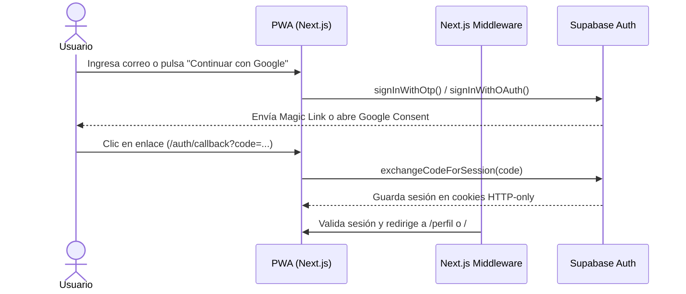

# 03. Autenticación y Perfil Dinámico

Guía de implementación de autenticación passwordless y el sistema dinámico de perfiles mutables.

---

## 1. Estrategia de Autenticación Mobile-First

En smartphones, recordar contraseñas largas genera fricción y caídas en el registro. Se adoptan dos métodos passwordless:
1. **Magic Link / Email OTP**: El usuario ingresa su correo electrónico y recibe un enlace directo de acceso de 1-click.
2. **Google OAuth**: Acceso instantáneo con la cuenta de Google configurada en el dispositivo móvil.

---

## 2. Flujo de Autenticación con SSR



---

## 3. Manejo de Perfiles y Atributos Mutables (JSONB)

### Disparador de Creación de Perfil
Al registrarse un nuevo usuario en `auth.users`, el trigger SQL `on_auth_user_created` inserta automáticamente una fila en `public.profiles` con su nombre y correo, y una fila vacía en `public.user_stats`.

### Campos Dinámicos
Los campos adicionales (posición en la cancha, pierna hábil, número de camiseta preferido) no requieren alterar tablas SQL.
1. Se consultan las definiciones en `public.profile_field_definitions`.
2. Se renderiza dinámicamente el control de entrada (`text`, `number`, `select`, `boolean`).
3. El formulario guarda el objeto consolidado en la columna `profiles.custom_attributes (JSONB)`:
   ```json
   {
     "posicion": "Mediocampista",
     "numero_camiseta": 10,
     "pie_habil": "Derecho"
   }
   ```

---

## 4. Almacenamiento de Avatares (Supabase Storage)

- **Bucket**: `avatars` (público para lectura optimizada de avatares).
- **Ruta de archivo**: `avatars/{userId}/{timestamp}.{ext}`.
- **Políticas RLS**: Los usuarios autenticados únicamente pueden insertar y actualizar sus propios archivos de avatar.
