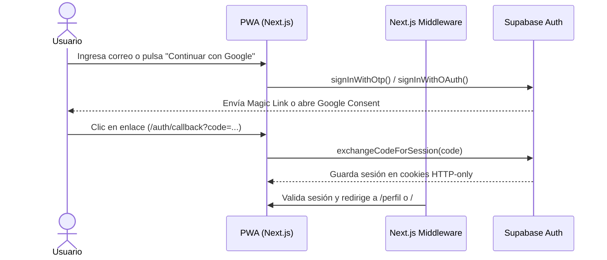

# 03. Autenticación y Perfil Dinámico

Guía de implementación de autenticación passwordless y el sistema dinámico de perfiles mutables.

---

## 1. Estrategia de Autenticación Mobile-First

En smartphones, recordar contraseñas largas genera fricción y caídas en el registro. Se adoptan dos métodos passwordless:
1. **Magic Link / Email OTP**: El usuario ingresa su correo electrónico y recibe un enlace directo de acceso de 1-click.
2. **Google OAuth**: Acceso instantáneo con la cuenta de Google configurada en el dispositivo móvil.

---

## 2. Flujo de Autenticación con SSR



---

## 3. Manejo de Perfiles y Atributos Mutables (JSONB)

### Disparador de Creación de Perfil
Al registrarse un nuevo usuario en `auth.users`, el trigger SQL `on_auth_user_created` inserta automáticamente una fila en `public.profiles` con su nombre y correo, y una fila vacía en `public.user_stats`.

### Campos Dinámicos
Los campos adicionales (posición en la cancha, pierna hábil, número de camiseta preferido) no requieren alterar tablas SQL.
1. Se consultan las definiciones en `public.profile_field_definitions`.
2. Se renderiza dinámicamente el control de entrada (`text`, `number`, `select`, `boolean`).
3. El formulario guarda el objeto consolidado en la columna `profiles.custom_attributes (JSONB)`:
   ```json
   {
     "posicion": "Mediocampista",
     "numero_camiseta": 10,
     "pie_habil": "Derecho"
   }
   ```

---

## 4. Almacenamiento de Avatares (Supabase Storage)

- **Bucket**: `avatars` (público para lectura optimizada de avatares).
- **Ruta de archivo**: `avatars/{userId}/{timestamp}.{ext}`.
- **Políticas RLS**: Los usuarios autenticados únicamente pueden insertar y actualizar sus propios archivos de avatar.

---

## 5. Configuración de Google OAuth en Supabase y Google Cloud Console

Para activar el inicio de sesión con Google en producción y desarrollo:

### Paso 1: Google Cloud Console
1. Ingresar a [Google Cloud Console](https://console.cloud.google.com/) y crear o seleccionar un proyecto.
2. Ir a **APIs & Services** > **OAuth consent screen**:
   - Tipo de usuario: **External** (Externo).
   - Completar nombre de app ("Club Deportivo"), correo de soporte y de desarrollador.
3. Ir a **Credentials** > **Create Credentials** > **OAuth client ID**:
   - Application type: **Web application**.
   - Name: `Club Deportivo Web Client`.
   - **Authorized JavaScript origins**:
     - `https://new-camp-app.vercel.app`
     - `https://qdscqskaridkcgfqzvej.supabase.co`
     - `http://localhost:3000`
   - **Authorized redirect URIs**:
     - `https://qdscqskaridkcgfqzvej.supabase.co/auth/v1/callback`
4. Copiar el **Client ID** y **Client Secret** generados.

### Paso 2: Supabase Dashboard
1. Ingresar al proyecto en [Supabase Dashboard](https://supabase.com/dashboard/project/qdscqskaridkcgfqzvej).
2. Ir a **Authentication** > **Providers** > **Google**.
3. Activar el interruptor **Enable Google provider**.
4. Pegar el **Client ID** y **Client Secret**.
5. Guardar los cambios.

### Paso 3: Supabase URL Configuration
1. Ir a **Authentication** > **URL Configuration**.
2. **Site URL**: `https://new-camp-app.vercel.app`
3. **Redirect URLs**:
   - `https://new-camp-app.vercel.app/**`
   - `http://localhost:3000/**`
   - `https://*.vercel.app/**`

