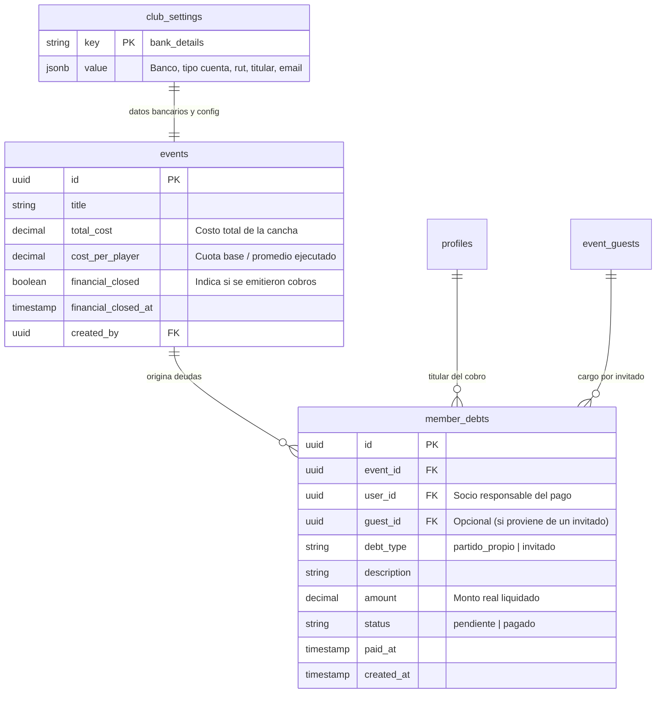
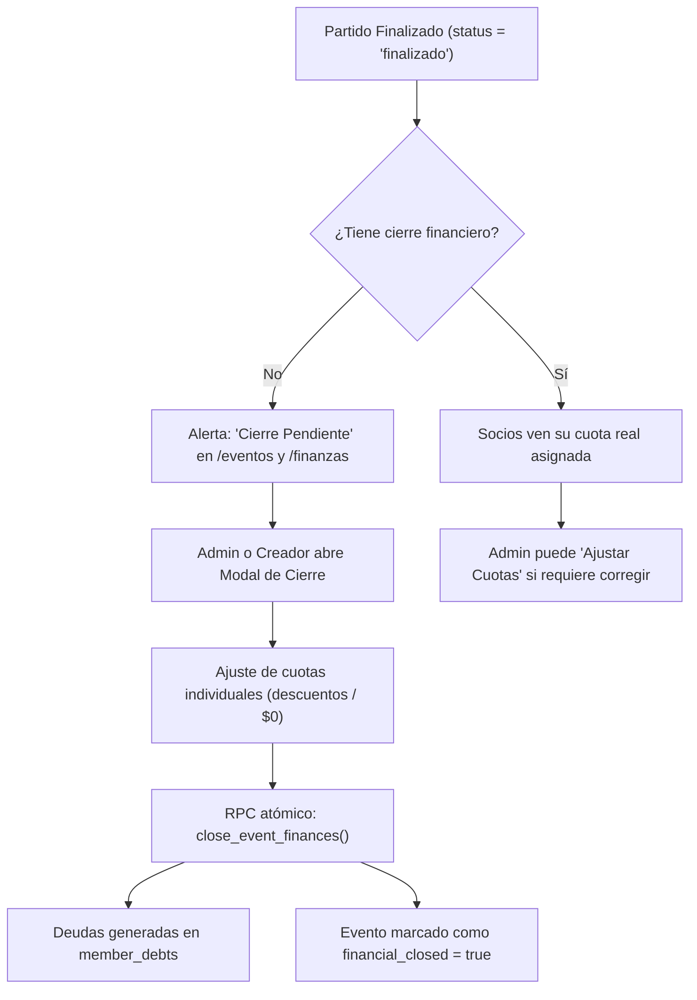

# 04. Módulo Financiero: Gestión de Deudas y Cierre de Partidos

Documentación técnica del sistema financiero, liquidación de canchas, cuenta corriente del socio, control de deudas y tesorería administrativa.

---

## 1. Arquitectura del Modelo Financiero

El sistema gestiona cobros tanto por **partido propio** como por **invitados externos** a cargo de cada socio, permitiendo costos fijos por jugador o prorrateo automático sobre el total de la cancha.

---

## 2. Flujo de Cierre Financiero Manual e Interactivo

Para evitar cobros rígidos y dar flexibilidad ante imprevistos (lesiones tempranas, becas, o invitados que pagan menos):

1. **Finalización del Encuentro**: El partido concluye en cancha (`status = 'finalizado'`), pero los cobros **no se emiten automáticamente** para dar margen al organizador de verificar quién asistió.
2. **Alertas de Partidos Pendientes**:
   - En [`/eventos`](../../src/app/eventos/page.tsx): Las tarjetas de partidos muestran la insignia `⚠️ Cierre Pendiente` y un filtro dedicado para administradores.
   - En [`/finanzas?tab=admin`](../../src/app/finanzas/page.tsx): Se despliega una tarjeta de alerta con los partidos sin liquidar y un botón directo **"Cerrar Finanzas"**.
3. **Personalización de Cuotas**:
   - En el modal de cierre ([`EventFinancialClosure.tsx`](../../src/components/EventFinancialClosure.tsx)), el creador o administrador puede modificar la cuota persona por persona (ej: rebajar a alguien de $3.000 a $2.000 o eximirlo a $0).
4. **Ejecución Atómica (`close_event_finances`)**:
   - Genera o actualiza las filas en `member_debts`.
   - Si un monto es $0, elimina cualquier cargo pendiente previo.
   - Actualiza `events.cost_per_player` con el promedio real ejecutado y marca `events.financial_closed = true`.

---

## 3. Resolución del Descalce de Montos e Inclusión de Invitados

Anteriormente, la vista de evento calculaba el costo dividiendo el valor de la cancha sobre la capacidad máxima teórica (`total_cost / max_capacity`), lo que generaba descalce si un administrador rebajaba la cuota, y omitía los cargos de los invitados traídos por el socio.

### Solución Implementada:
- [`src/app/eventos/[id]/page.tsx`](../../src/app/eventos/[id]/page.tsx) consulta todas las deudas registradas en `member_debts` asociadas al `user_id` del socio para ese evento (tanto de tipo `partido_propio` como `invitado`).
- Si el partido ya fue cerrado financieramente:
  - **Monto Consolidado**: Se calcula `userTotalDebtAmount = userOwnDebt.amount + SUM(userGuestDebts.amount)`.
  - **Encabezado**: Muestra **Tu cuota liquidada: $TOTAL**.
  - **Desglose de Invitados**: Si el socio tiene invitados a cargo, se despliega explícitamente el detalle: `(Propia: $X + N invitado(s): $Y)`.
  - **Insignia de Pago**: Evalúa todas las deudas del socio para el evento; solo muestra `✓ Al día` si todas las obligaciones (propias y de invitados) están saldadas.
  - **Cuadro Personalizado**: En la sección de cierre financiero se detallan tanto la cuota personal como el subtotal por los invitados a su cargo.
- En [`src/app/finanzas`](../../src/app/finanzas/page.tsx), tanto el socio como el tesorero ven exactamente las mismas cifras sin discrepancias.

---

## 4. Panel de Tesorería Administrativa (`FinanzasAdminPanel`)

Ubicado en la pestaña `/finanzas?tab=admin`:
1. **KPIs Globales**: Total acumulado por cobrar y número de cargos pendientes.
2. **Partidos Pendientes de Cierre**: Lista con accesos directos para liquidar eventos finalizados.
3. **Saneamiento de Deudas**:
   - Agrupación por socio con desglose de partidos propios e invitados.
   - Botón **"Marcar al Día"** (`settleMemberDebtsAction`) para registrar pagos por transferencia o efectivo.
   - Botón de reversión individual por si se cometió un error.
4. **Configuración de Cuenta Bancaria**:
   - Modal para actualizar banco, tipo de cuenta, número, titular, RUT y correo sin acceder a consolas de base de datos.
   - Los datos se guardan en `club_settings` o en `clubs.settings.bank_details`.
   - **Desacoplamiento Visual**: La selección de paletas y colores institucionales fue trasladada desde este panel a la nueva interfaz de edición de club ([`/club/editar`](../../src/app/club/editar/page.tsx)), manteniendo el módulo financiero enfocado 100% en tesorería y cuentas bancarias.

---

## 5. Experiencia del Socio (`FinanzasMemberView`)

Ubicado en la pestaña `/finanzas?tab=socio`:
- **Estado de Cuenta Personal**: Resumen de total adeudado.
- **Detalle de Partidos**: Desglose claro indicando si la deuda corresponde a la propia asistencia o a un invitado que el socio trajo al club.
- **Botón "Copiar Datos de Transferencia"**: Permite copiar al portapapeles en un toque todos los datos bancarios del club para transferir desde la app del banco sin fricciones.
