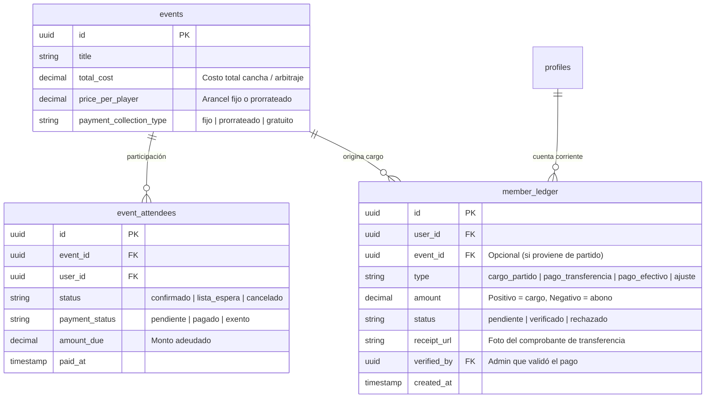

# 04. Módulo Financiero: Gestión de Deudas y Cobro de Partidos

Especificación técnica de la arquitectura prevista para el control de aranceles, cobros de canchas, cuenta corriente del socio y estado de deudas por evento deportivo.

---

## 1. Viabilidad Arquitectónica

La arquitectura actual está **100% preparada** para incorporar el módulo de deudas sin requerir refactorizaciones destructivas:
- **Base Relacional**: `events` y `event_attendees` ya identifican con exactitud qué jugadores confirmaron y jugaron cada encuentro.
- **Auditoría**: `event_attendance_logs` ya registra los presentes y las bajas de último minuto (para saber a quién cobrarle o penalizarle).
- **Extensibilidad**: El modelo soporta tanto campos directos en `events` y `event_attendees` como una tabla ledger de cuenta corriente.

---

## 2. Modelo de Datos Propuesto para Deudas

---

## 3. Flujo Funcional de Cobro

1. **Configuración del Evento**:
   - Al crear el partido, el administrador define el costo:
     - *Opción A (Monto Fijo)*: Ej. $3.500 por jugador.
     - *Opción B (Prorrateado)*: Ej. Cancha de $42.000 dividido entre los 14 jugadores confirmados ($3.000 c/u).
2. **Generación Automática del Cargo**:
   - Al finalizar el partido (`status = 'finalizado'`), se generan los cargos a los jugadores que asistieron.
3. **Experiencia del Jugador (Mobile PWA)**:
   - En su **Perfil** o **Dashboard**: Banner visible *"Tienes 1 partido pendiente de pago: $3.500"*.
   - Botón *"Subir comprobante de transferencia"* o integración directa con pasarela de pago (ej. Mercado Pago).
4. **Validación del Administrador**:
   - Pestaña administrativa *"Finanzas / Cobranzas"* donde el tesorero o admin ve la lista de socios con saldo deudor y valida transferencias con un click.
