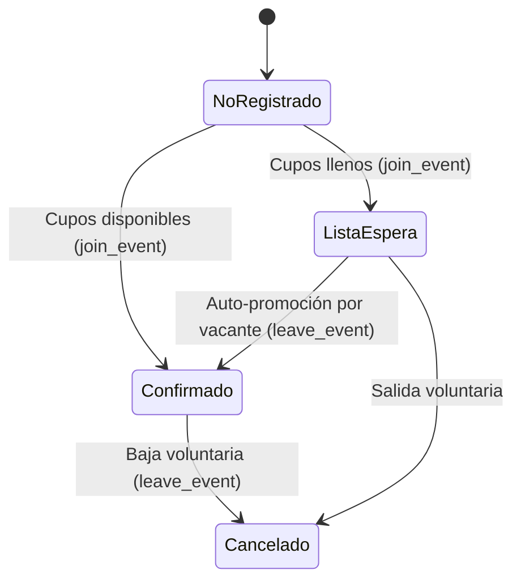

# 05. Módulo de Eventos, Cupos y Lista de Espera Automática

Especificación funcional y técnica de la convocatoria de partidos, control estricto de cupos, gestión de lista de espera con auto-promoción atómica y bitácora de auditoría inmutable.

---

## 1. Principio de Concurrencia y Auto-Promoción

En grupos de fútbol y deportes de club, las bajas de último minuto ocurren frecuentemente. Para evitar la desorganización de los cupos y la intervención manual de los administradores:
1. Si un evento tiene `max_capacity` definido y se llena, los socios que confirmen a continuación entran automáticamente con estado `lista_espera`.
2. Cuando cualquier jugador confirmado se baja (acción `bajo` en auditoría):
   - Su estado cambia a `cancelado`.
   - El procedimiento almacenado atómico `leave_event` selecciona al primer socio en lista de espera por orden de registro (`registered_at ASC`), bloqueando la fila con `FOR UPDATE SKIP LOCKED`.
   - Dicho jugador asciende inmediatamente a `confirmado` (`action = 'subio_espera'`).
   - Se retorna el ID del usuario promovido para disparar la notificación Web Push.

---

## 2. Componentes y Flujos de Pantalla

| Ruta | Componente | Función |
| :--- | :--- | :--- |
| `/eventos` | [`EventosPage`](file:///Users/seba/CampApp/src/app/eventos/page.tsx) | Feed mobile de eventos con filtros (Partidos, Asados, Entrenamientos, Finalizados) y barras de progreso de cupos. |
| `/eventos/nuevo` | [`NuevoEventoPage`](file:///Users/seba/CampApp/src/app/eventos/nuevo/page.tsx) | Formulario restringido a administradores para convocar eventos con fecha, hora, lugar y cupo máximo. |
| `/eventos/[id]` | [`EventDetailPage`](file:///Users/seba/CampApp/src/app/eventos/[id]/page.tsx) | Ficha del evento con botón 1-click CTA, listado de confirmados, lista de espera ordenada y auditoría. |
| Componente | [`EventAttendanceCTA`](file:///Users/seba/CampApp/src/components/EventAttendanceCTA.tsx) | Control interactivo móvil con confirmación 1-click, advertencia de lista de espera y modal de baja. |
| Componente | [`EventAdminControls`](file:///Users/seba/CampApp/src/components/EventAdminControls.tsx) | Botones rápidos para que los administradores inicien, finalicen o cancelen el evento. |

---

## 3. Bitácora de Auditoría Inmutable (`event_attendance_logs`)

Todos los movimientos quedan registrados de manera append-only:
- `confirmo`: El socio confirmó su presencia.
- `bajo`: El socio se bajó voluntariamente (con motivo opcional).
- `entro_espera`: El socio quedó en lista de espera por cupo lleno.
- `subio_espera`: El socio ascendió automáticamente por liberación de cupo.
- `solicito_invitado`: Se solicitó un invitado externo.
- `invitado_aprobado`: El administrador aprobó al invitado.
- `invitado_rechazado`: El administrador rechazó la solicitud.
