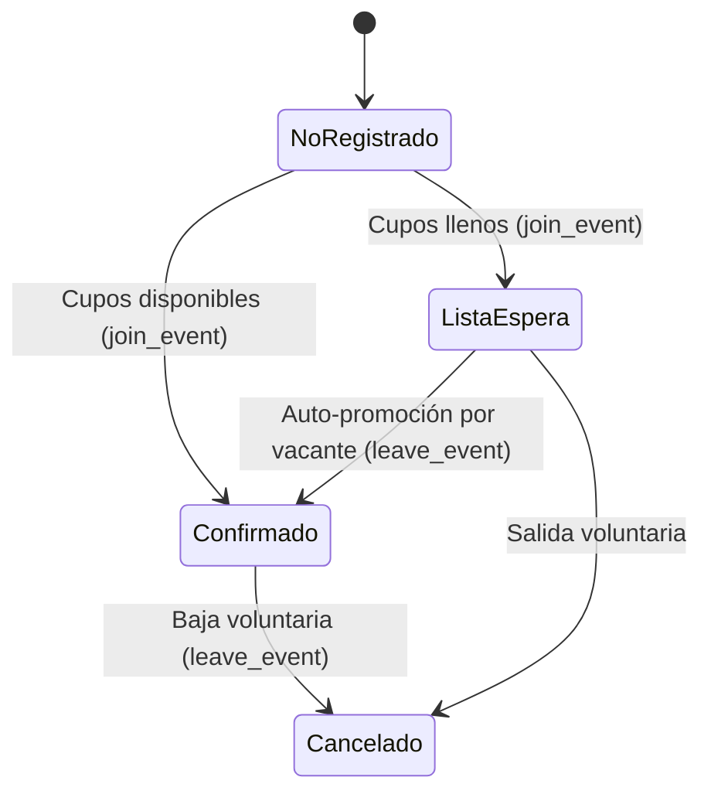

# 05. Módulo de Eventos, Cupos y Lista de Espera Automática

Especificación funcional y técnica de la convocatoria de partidos, control estricto de cupos, gestión de lista de espera con auto-promoción atómica y bitácora de auditoría inmutable.

---

## 1. Principio de Concurrencia y Auto-Promoción

En grupos de fútbol y deportes de club, las bajas de último minuto y las inscripciones simultáneas ocurren con frecuencia. Para evitar la desorganización de los cupos, sobrecupos (*overbooking*) y la intervención manual de los administradores:

1. **Prevención de Condiciones de Carrera (Pessimistic Locking `FOR UPDATE`)**:
   - Tanto `join_event`, `leave_event` como `promote_waitlist` adquieren un cerrojo exclusivo a nivel de fila (`SELECT ... FROM events WHERE id = p_event_id FOR UPDATE`).
   - Si dos jugadores intentan anotarse exactamente en el mismo milisegundo por el último cupo, PostgreSQL serializa las transacciones: la primera reserva el cupo como `confirmado` y la segunda, al ejecutarse inmediatamente después con el conteo actualizado, queda asignada de forma atómica y determinista a `lista_espera`.
2. **Control Estricto de Capacidad**:
   - Si un evento tiene `max_capacity` definido y se llena, los socios que confirmen a continuación entran automáticamente con estado `lista_espera`.
3. **Auto-Promoción Atómica por Baja**:
   - Cuando cualquier jugador confirmado se baja (acción `bajo` en auditoría vía `leave_event`):
     - Su estado cambia a `cancelado`.
     - El procedimiento atómico `promote_waitlist` evalúa la cola unificada de socios e invitados en espera por orden cronológico (`queue_time ASC`).
     - El primer candidato asciende inmediatamente a `confirmado` (`action = 'subio_espera'`).
     - Se retorna el registro del promovido para disparar la notificación Web Push en tiempo real.

---

## 2. Tipología, Categorías de Género y Versatilidad de Eventos

La plataforma simplifica la organización reduciendo los tipos principales a tres, con máxima flexibilidad:

1. **Partidos (`partido`)**:
   - Convocatoria deportiva estándar.
   - Permite especificar el **costo total de la cancha** y calcula el prorrateo automático sobre la capacidad máxima convocada (ej: Cancha $42.000 ÷ 14 cupos = ~$3.000 p/jugador), permitiendo a los socios conocer la cuota aproximada antes de inscribirse.
   - Al finalizar, es el **único tipo de evento que habilita la votación democrática de MVP**.
2. **Entrenamientos (`entrenamiento`)**:
   - Soporta especificar tanto el **costo total de la sesión** como una **cuota fija por jugador**.
3. **Otros Eventos Mutables (`otro`)**:
   - Diseñado para juntas, asados, asambleas de directorio o eventos sociales.
   - **Campos Dinámicos (`custom_fields` JSONB)**: Permite a los organizadores agregar o quitar campos arbitrarios al vuelo (ej: *"Cuota Asado"*, *"Encargado de Bebidas"*, *"Parrilla"*), adaptándose a cualquier necesidad del club sin modificar esquemas SQL.

### Categoría de Género del Evento (`gender_category`)
Al crear un evento, el convocante define la modalidad:
- `mixto` (👫 Mixto): Abierto a todos los socios registrados sin distinción.
- `masculino` (👨 Masculino): Exclusivo para socios con género masculino configurado en su perfil.
- `femenino` (👩 Femenino): Exclusivo para socias con género femenino configurado en su perfil.

**Validación de Inscripción**: En [`toggleEventAttendance`](../../src/app/eventos/actions.ts), si el evento es categorizado (`masculino` o `femenino`), se exige que el socio tenga definido su género en su perfil y que este coincida con la categoría del evento. En caso contrario, se bloquea la inscripción con un mensaje informativo guiando al socio a completar su perfil.

### Convocatorias, Edición y Moderación
- **Atribución de Creador**: Cada evento muestra claramente quién lo convocó en la cabecera.
- **Aprobación de Eventos**: Si un socio no-administrador crea un evento, este queda en estado `pendiente_aprobacion` hasta que un administrador lo revise y autorice.
- **Edición Post-Convocatoria ([`/eventos/[id]/editar`](../../src/app/eventos/[id]/editar/page.tsx))**:
  - Habilitada exclusivamente para el **creador de la convocatoria** o **administradores del club**.
  - Permite rectificar o modificar cualquier parámetro post-creación:
    - Título del evento y descripción/instrucciones generales.
    - Tipo de evento (`partido`, `entrenamiento`, `otro`).
    - Categoría de género (`mixto`, `masculino`, `femenino`).
    - Fecha y hora de inicio.
    - Sede / Cancha / Ubicación.
    - Cupo máximo (`max_capacity`): si el cupo se incrementa o se elimina el límite, el sistema ejecuta de inmediato `promote_waitlist` en bucle para promover automáticamente a los socios e invitados que estaban en espera, notificándolos por push.
    - Configuración de costos (cancha total para prorrateo automático, cuota fija o gratuito) y campos dinámicos mutables para eventos tipo "otro".
  - **Accesos Rápidos**:
    1. En el panel de control del evento [`EventAdminControls.tsx`](../../src/components/EventAdminControls.tsx) mediante el botón destacado **"Editar Convocatoria"**.
    2. En la barra superior de acciones junto a los botones de compartir y calendario.
- **Ciclo de Estados Simplificado**: Las convocatorias pasan directamente de `convocado` a `finalizado` (abriendo el cierre financiero y el MVP en partidos) o `cancelado`.

---

## 3. Lista de Espera Unificada (Socios + Invitados)

La lista de espera no discrimina el tipo de postulante una vez aprobada la postulación externa:
1. **Cola Cronológica Estricta**: Se ordena por marca temporal de solicitud (`queue_time = registered_at` para socios y `created_at` para invitados en espera).
2. **Auto-Promoción Multicausal**: Se activa ante cualquiera de los siguientes disparadores:
   - Baja voluntaria de un socio confirmado (`leave_event`).
   - Cambio de modalidad de un socio confirmado de jugador a espectador (`join_event`).
   - Cancelación o rechazo de un invitado que estaba previamente confirmado (`cancelGuestRequest`, `rejectGuest`).
   - Aumento manual del cupo en la edición de la convocatoria (`updateEventAction`).
3. **Identificación Visual Transparente**: La tarjeta *"Lista de Espera Oficial"* numera secuencialmente las posiciones (`#1, #2...`), resalta al usuario actual con tag *"Tú"*, y muestra las insignias de invitados externos (`Invitado de [Nombre Socio]` o *"Tu Invitado"*).

---

## 3. Utilidades de Convocatoria Móvil

### 1. Botón "Add to Calendar" ([`AddToCalendarButton.tsx`](../../src/components/AddToCalendarButton.tsx))
Ubicado en la cabecera del detalle de cada evento, permite agendar el partido con un toque:
- **Google Calendar**: Construye una URL con codificación `action=TEMPLATE` incluyendo título, descripción, ubicación y marcas horarias ISO en formato UTC.
- **Apple Calendar / Outlook (`.ics`)**: Genera y descarga un archivo estándar `iCalendar` (RFC 5545) compatible de forma nativa con iPhone (iOS Calendar), Mac y clientes de escritorio.

### 2. Compartir Convocatoria ([`ShareEventButton.tsx`](../../src/components/ShareEventButton.tsx))
- En dispositivos móviles utiliza la **Web Share API** nativa (`navigator.share`) para compartir directamente por **WhatsApp**, Telegram o Mensajes con un resumen formateado del partido (lugar, fecha, costo por jugador y cupos disponibles).
- En navegadores de escritorio cuenta con fallback automático para copiar el enlace y texto al portapapeles.

---

## 4. Componentes y Flujos de Pantalla

| Ruta | Componente | Función |
| :--- | :--- | :--- |
| `/eventos` | [`EventosPage`](../../src/app/eventos/page.tsx) | Feed mobile de eventos con filtros (Partidos, Asados, Entrenamientos, Finalizados) y barras de progreso de cupos. |
| `/eventos/nuevo` | [`NuevoEventoPage`](../../src/app/eventos/nuevo/page.tsx) | Formulario restringido a administradores para convocar eventos con fecha, hora, lugar y cupo máximo. |
| `/eventos/[id]` | [`EventDetailPage`](../../src/app/eventos/[id]/page.tsx) | Ficha del evento con botón 1-click CTA, listado de confirmados, lista de espera ordenada y auditoría. |
| `/eventos/[id]/editar` | [`EditarEventoPage`](../../src/app/eventos/[id]/editar/page.tsx) | Edición post-convocatoria completa (título, costos, fecha, hora, lugar, categoría, cupo y campos mutables) para admins y creador. |
| Componente | [`EditEventForm`](../../src/components/EditEventForm.tsx) | Formulario táctil interactivo pre-poblado con revalidación y auto-promoción de lista de espera. |
| Componente | [`EventAttendanceCTA`](../../src/components/EventAttendanceCTA.tsx) | Control interactivo móvil con confirmación 1-click, advertencia de lista de espera y modal de baja. |
| Componente | [`EventAdminControls`](../../src/components/EventAdminControls.tsx) | Botones rápidos para que los administradores editen, aprueben convocatorias, finalicen o cancelen el evento. |

---

## 5. Bitácora de Auditoría Inmutable (`event_attendance_logs`)

Todos los movimientos quedan registrados de manera append-only:
- `confirmo`: El socio confirmó su presencia como jugador.
- `confirmo_espectador`: El socio confirmó asistencia como espectador (no consume cupo en cancha).
- `bajo`: El socio se bajó voluntariamente (con motivo opcional).
- `entro_espera`: El socio quedó en lista de espera por cupo lleno.
- `subio_espera`: El socio o invitado ascendió automáticamente por liberación de cupo.
- `solicito_invitado`: Se solicitó un invitado externo.
- `invitado_aprobado`: El administrador aprobó al invitado para jugar en cancha.
- `invitado_espera`: El administrador aprobó al invitado pero quedó en lista de espera por cupo completo.
- `invitado_rechazado`: El administrador rechazó la solicitud.
