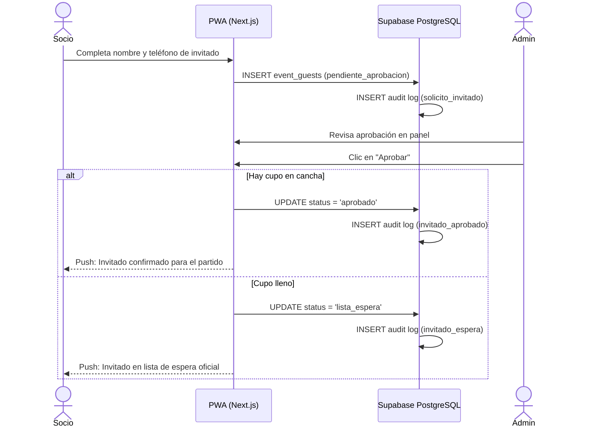

# 06. Módulo de Invitados y Moderación Administrativa

Especificación del flujo de solicitud de invitados externos por parte de socios, verificación de cupos y moderación rápida para administradores.

---

## 1. Reglas de Negocio

1. **Postulación**:
   - Cualquier socio puede postular a un amigo/invitado externo para un evento abierto ingresando su nombre y contacto opcional (WhatsApp).
   - El invitado se almacena en `event_guests` en estado `pendiente_aprobacion`.
   - **Importante**: No consume cupo oficial mientras permanezca pendiente.
2. **Aprobación de la Administración y Lista de Espera**:
   - El administrador cuenta con dos accesos: dentro del detalle de cada evento (`/eventos/[id]`) o en el centro de moderación consolidado (`/admin/invitados`).
   - Al pulsar **Aprobar**:
     - Se valida la capacidad actual `(confirmados + invitados_aprobados)`.
     - **Si hay cupo disponible**: cambia a `status = 'aprobado'`, suma a la lista oficial de confirmados en cancha y se audita con `invitado_aprobado`. Se notifica al socio por push de la confirmación oficial.
     - **Si el cupo está completo (`totalConfirmed >= max_capacity`)**: el invitado es aprobado pero ingresa automáticamente a **`status = 'lista_espera'`**, auditándose con `invitado_espera`.
     - Se notifica por push al socio postulante: *"Tu invitado [Nombre] fue aprobado pero quedó en lista de espera por cupo completo"*.
     - El invitado se integra de inmediato a la **cola unificada de lista de espera** y ascenderá de forma automática a `aprobado` mediante el RPC `promote_waitlist` en cuanto se libere una vacante.
3. **Rechazo o Cancelación**:
   - El administrador puede rechazar la postulación (`status = 'rechazado'`).
   - El socio postulante puede cancelar su solicitud en cualquier momento mientras siga en estado `pendiente_aprobacion` o `lista_espera`.
   - Si se cancela o rechaza a un invitado que ya estaba **aprobado/confirmado**, el sistema libera la plaza automáticamente y promueve al siguiente socio o invitado de la lista de espera mediante `promote_waitlist`.
   - Todo movimiento se asienta de forma inmutable en `event_attendance_logs`.

---

## 2. Componentes y Acciones

- [`guest-actions.ts`](../../src/app/eventos/guest-actions.ts): Server Actions para `requestGuest`, `cancelGuestRequest`, `approveGuest` y `rejectGuest`.
- [`GuestInviteModal.tsx`](../../src/components/GuestInviteModal.tsx): Modal mobile-first para solicitar invitados.
- [`EventGuestsSection.tsx`](../../src/components/EventGuestsSection.tsx): Tarjetas de moderación rápida 1-tap para administradores y vista de "Mis Invitaciones" para socios.
- [`/admin/invitados`](../../src/app/admin/invitados/page.tsx): Centro administrativo de moderación consolidada entre todos los eventos próximos.
