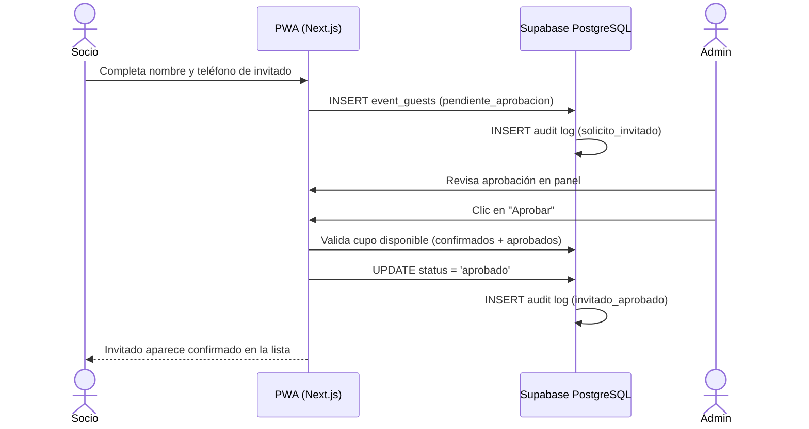

# 06. Módulo de Invitados y Moderación Administrativa

Especificación del flujo de solicitud de invitados externos por parte de socios, verificación de cupos y moderación rápida para administradores.

---

## 1. Reglas de Negocio

1. **Postulación**:
   - Cualquier socio puede postular a un amigo/invitado externo para un evento abierto ingresando su nombre y contacto opcional (WhatsApp).
   - El invitado se almacena en `event_guests` en estado `pendiente_aprobacion`.
   - **Importante**: No consume cupo oficial mientras permanezca pendiente.
2. **Aprobación de la Administración**:
   - El administrador cuenta con dos accesos: dentro del detalle de cada evento (`/eventos/[id]`) o en el centro de moderación consolidado (`/admin/invitados`).
   - Al pulsar **Aprobar**:
     - Se valida que `(confirmados + invitados_aprobados) < max_capacity`.
     - Si hay cupo, cambia a `aprobado`, suma a la lista oficial de confirmados y se audita con `invitado_aprobado`.
     - Si no hay cupo, se alerta al administrador.
3. **Rechazo o Cancelación**:
   - El administrador puede rechazar la postulación (`rechazado`).
   - El socio postulante puede cancelar su solicitud en cualquier momento mientras siga pendiente.
   - Todo movimiento se asienta de forma inmutable en `event_attendance_logs`.

---

## 2. Componentes y Acciones

- [`guest-actions.ts`](file:///Users/seba/CampApp/src/app/eventos/guest-actions.ts): Server Actions para `requestGuest`, `cancelGuestRequest`, `approveGuest` y `rejectGuest`.
- [`GuestInviteModal.tsx`](file:///Users/seba/CampApp/src/components/GuestInviteModal.tsx): Modal mobile-first para solicitar invitados.
- [`EventGuestsSection.tsx`](file:///Users/seba/CampApp/src/components/EventGuestsSection.tsx): Tarjetas de moderación rápida 1-tap para administradores y vista de "Mis Invitaciones" para socios.
- [`/admin/invitados`](file:///Users/seba/CampApp/src/app/admin/invitados/page.tsx): Centro administrativo de moderación consolidada entre todos los eventos próximos.
