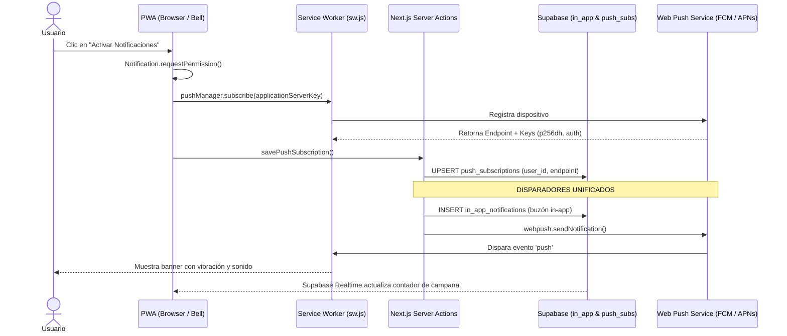

# 08. Progressive Web App (PWA) y Sistema Unificado de Notificaciones

Documentación técnica del soporte PWA standalone, Service Worker, buzón In-App y entrega de notificaciones Web Push segmentadas por club con VAPID.

---

## 1. Arquitectura PWA Mobile-First

1. **Manifest Standalone (`public/manifest.json`)**:
   - `display: standalone`: Oculta la barra de navegación del navegador (Safari / Chrome), ejecutando la aplicación a pantalla completa como una app nativa.
   - `theme_color: #059669`: Tinte de barra de estado móvil reactivo a la paleta activa del club.
   - Iconos PWA: Generados en 192x192 y 512x512 maskable en `public/icons/`.
2. **Instalación Ergonómica**:
   - Componente [`PwaPrompt.tsx`](../../src/components/PwaPrompt.tsx):
     - **En Android / Chrome**: Captura el evento `beforeinstallprompt` y presenta un botón *"Instalar App"*.
     - **En iOS Safari**: Detecta el dispositivo e instruye al usuario a usar *"Compartir" -> "Agregar a Inicio"*.

---

## 2. Web Push Notifications (VAPID) y Vinculación a Nivel de Cuenta

La plataforma utiliza el estándar **Web Push W3C** firmado criptográficamente con claves VAPID (Voluntary Application Server Identification), permitiendo enviar notificaciones push en segundo plano sin depender de tiendas de aplicaciones (App Store / Google Play).

### Desacople entre Permiso del Navegador y Cuenta de Usuario
Un error común en PWAs compartidas o al probar múltiples perfiles en un mismo dispositivo es asumir que si `Notification.permission === 'granted'`, el usuario actual ya está suscrito. 
- `Notification.permission` es una propiedad **del dispositivo/origen**, no de la cuenta.
- Si el usuario A activó notificaciones y luego el usuario B inicia sesión en ese mismo teléfono, la app validaba incorrectamente que las notificaciones estaban listas, impidiendo que el usuario B guardara su suscripción en la base de datos.

### Solución Implementada ([`AppOnboardingModal.tsx`](../../src/components/AppOnboardingModal.tsx)):
1. **Comprobación en Servidor**: El servidor consulta la tabla `push_subscriptions` filtrando por `user_id = user.id` (`hasPushSub`).
2. **Auto-Sincronización Silenciosa**: Si el navegador ya tiene permisos (`permission === 'granted'`) pero la cuenta no registra suscripción en la BD, la aplicación registra el endpoint del dispositivo y lo asocia automáticamente a la cuenta activa en segundo plano.
3. **Botón Dinámico de Vinculación**: Si se requiere acción manual, el botón cambia a *"Vincular Notificaciones a mi Cuenta"*.
4. **Caché de Descarte Scoped**: El descarte del modal se guarda en `localStorage` con la clave `campapp_onboarding_dismissed_${userId}`, asegurando que cada nuevo jugador que ingrese al dispositivo reciba su respectivo onboarding y recordatorio para completar sus datos.

---

## 3. Arquitectura de Notificaciones In-App (Buzón Oficial)

Para garantizar que los socios que no hayan instalado la PWA o tengan los permisos bloqueados en el sistema operativo no pierdan mensajes vitales, se implementó el **Buzón In-App**:

1. **Tabla `in_app_notifications`**:
   - `id`: UUID único.
   - `user_id`: Destinatario de la alerta.
   - `club_id`: Identificador del club (aislamiento multi-tenant).
   - `title` & `body`: Contenido de la alerta.
   - `url`: Enlace de redirección al pulsar la notificación.
   - `type`: Categoría tipada (`evento`, `finanzas`, `membresia`, `mvp`, `admin`, `recordatorio`, `sistema`).
   - `is_read`: Estado de lectura booleano.
   - `created_at`: Marca temporal.
2. **Componente [`NotificationBell.tsx`](../../src/components/NotificationBell.tsx)**:
   - Campana táctil ubicada en las cabeceras principales (`/`, `/eventos`, `/miembros`, `/finanzas`).
   - Insignia (*badge*) con conteo en vivo de notificaciones no leídas.
   - Modal deslizable (*slide-over sheet*) con filtros "Todas" y "Sin leer", botón "Marcar todas como leídas", enlaces directos y tiempos relativos ergonómicos.
   - **Suscripción Realtime**: Escucha eventos `INSERT` y `UPDATE` en tiempo real vía WebSocket de Supabase, actualizando la campana sin necesidad de recargar la página.

---

## 4. Segmentación Multi-Club

Para prevenir fugas de notificaciones entre clubes distintos alojados en la misma base de datos, los helpers de despacho operan con aislamiento estricto:

* **`sendPushToClubMembers(clubId, payload, excludeUserId?)`**:
  Obtiene los dispositivos de socios aprobados pertenecientes exclusivamente a `clubId` mediante la función PostgreSQL `get_club_members_push_subscriptions` y registra en bloque las alertas en `in_app_notifications`.
* **`sendPushToClubAdmins(clubId, payload, excludeUserId?)`**:
  Filtra únicamente a los usuarios con rol `'admin'` dentro de `clubId` mediante `get_club_admins_push_subscriptions`.
* **Prefijo Dinámico de Contexto**:
  Todas las alertas anteponen `[Nombre del Club]` en su título para que socios con membresías en múltiples clubes identifiquen el origen al instante.

---

## 5. Mapeo Completo de los 11 Disparadores

| # | Canal / Disparador | Destinatario | Título y Resumen | Módulo / Archivo |
|---|---|---|---|---|
| **1** | **Nueva Convocatoria Abierta** | Socios del club | `[Club] ⚽ Nueva Convocatoria: [Partido]` Lista abierta para confirmar asistencia. | [`approveEventAction` / `createEvent`](../../src/app/eventos/actions.ts) |
| **2** | **Emisión de Cobro / Cierre Financiero** | Confirmados con saldo | `[Club] 💳 Cobro de Partido: [Título]` Aporte a transferir según cierre de tesorería. | [`closeEventFinancesAction` / `generateEventDebtsAction`](../../src/app/eventos/actions.ts) |
| **3** | **Confirmación de Pago (Saneamiento)** | Socio saldado | `[Club] ✅ Pago Registrado` Aviso de cuenta al día tras revisión del tesorero. | [`settleMemberDebtsAction`](../../src/app/finanzas/actions.ts) |
| **4** | **Anuncio del Ganador del MVP** | Ganador(es) y plantel | `[Club] 🌟 ¡Elegido MVP del Partido!` / `🏆 Resultado MVP` Reconocimiento a la figura votada. | [`closeMvpVoting`](../../src/app/eventos/mvp-actions.ts) |
| **5** | **Aviso de Nueva Solicitud de Pase** | Administradores | `[Club] 📋 Nueva Solicitud de Pase` / `📨 Solicitud Reenviada` Alerta de socio pendiente de admisión. | [`joinClubAction` / `submitMotivationAction`](../../src/app/club/actions.ts) |
| **6** | **Aviso de Solicitud de Invitado Externo** | Administradores | `[Club] 👤 Solicitud de Invitado` Un socio propone un invitado para el partido. | [`requestGuest`](../../src/app/eventos/guest-actions.ts) |
| **7** | **Baja y Alerta de Cupo Libre** | Administradores | `[Club] ⚠️ Cupo Libre en Convocatoria` Baja sin lista de espera para cubrir el cupo. | [`leaveEvent`](../../src/app/eventos/actions.ts) |
| **8** | **Cancelación o Reprogramación** | Confirmados y Espera | `[Club] ❌ Partido Cancelado` Aviso formal de suspensión del evento. | [`rejectEventAction` / `updateEventStatus`](../../src/app/eventos/actions.ts) |
| **9** | **Recordatorio 24h Previas** | Confirmados | `[Club] ⏰ Recordatorio: Partido próximo` Aviso de hora y lugar con opción de liberarse. | [`/api/cron/reminders`](../../src/app/api/cron/reminders/route.ts) |
| **10** | **Recordatorio de Votación MVP por Vencer** | Confirmados sin votar | `[Club] ⏳ ¡Últimas horas para votar al MVP!` Alerta a 4 horas del vencimiento. | [`/api/cron/reminders`](../../src/app/api/cron/reminders/route.ts) |
| **11** | **Ascenso a Administrador / Capitán** | Socio promovido | `[Club] 🛡️ Ahora eres Administrador` Confirmación de asignación de rol directivo. | [`updateMemberRoleAction`](../../src/app/miembros/actions.ts) |

---

## 6. Automatizaciones y Endpoint Cron

La verificación de recordatorios se ejecuta a través del servicio [`processAutomatedReminders`](../../src/app/api/notifications/reminders.ts) expuesto en `/api/cron/reminders`:

* Soporta protección mediante cabecera `Authorization: Bearer <CRON_SECRET>`.
* Marca las banderas `reminder_24h_sent` y `reminder_mvp_sent` en la tabla `events` para garantizar **idempotencia total** (evitando envíos duplicados).

---

## 7. Pestaña de Gestión y Preferencias de Notificaciones

Para evitar la saturación de alertas y permitir que cada socio configure exactamente qué notificaciones desea recibir en su dispositivo, se implementó el panel de preferencias de notificaciones:

### 1. Puntos de Entrada Ergonómicos
- **Pestaña "Ajustes" en el Centro de Notificaciones ([`NotificationBell.tsx`](../../src/components/NotificationBell.tsx))**:
  Al abrir la campana, el socio puede alternar entre *"Todas"*, *"Sin leer"* y la nueva pestaña *"Ajustes ⚙️"*, sin salir del modal.
- **Ficha en Perfil Oficial ([`ProfileNotificationCard.tsx`](../../src/components/ProfileNotificationCard.tsx))**:
  Ubicada en `/perfil` junto a *Tema y Apariencia*, permite expandir la consola de configuración con un toque.

### 2. Presets Rápidos de 1 Toque
- **🎯 Esencial**: Convocatorias + Finanzas + Lista de Espera (silencia MVP y recordatorios 24h, ideal para socios que solo necesitan saber cuándo juegan, si entraron y cuánto pagar).
- **⭐ Completo**: Todas las alertas habilitadas (por defecto).
- **🔕 Mínimo**: Únicamente avisos de tesorería y cobros de partidos.

### 3. Categorías Granulares Configurables
1. **Convocatorias Nuevas**: Apertura de listas de partidos y entrenamientos.
2. **Equipos y Formaciones**: Publicación de escuadras por la capitanía.
3. **Recordatorios 24 Horas**: Aviso un día antes con hora, cancha y recordatorio de baja.
4. **Lista de Espera**: Promoción automática inmediata a cupo confirmado.
5. **Cobros y Pagos (Finanzas)**: Aportes a transferir y validación de pagos recibidos.
6. **Votaciones y Premios MVP**: Avisos para votar y resultados de la figura del partido.
7. **Mis Invitados Externos**: Confirmación o rechazo de postulaciones de invitados.
8. **Capitanía y Administración**: Solicitudes de pases, moderación de invitados y cupos libres (se muestra automáticamente para administradores).

### 4. Filtrado Activo en el Despacho
Las funciones de envío ([`sendPushToUser`](../../src/app/api/push/actions.ts), [`sendPushToClubMembers`](../../src/app/api/push/actions.ts) y [`processAutomatedReminders`](../../src/app/api/notifications/reminders.ts)) consultan las preferencias efectivas del jugador antes de enviar la alerta; si el socio tiene desactivada esa categoría o el canal Web Push/In-App, el mensaje no se despacha.

### 5. Persistencia Dual
- Tabla PostgreSQL `public.user_notification_preferences` ([`014_user_notification_preferences.sql`](../../supabase/migrations/014_user_notification_preferences.sql)).
- Respaldo automático en `profiles.custom_attributes.notification_preferences` para asegurar funcionamiento inmediato sin fricción ni fallos de esquema.
