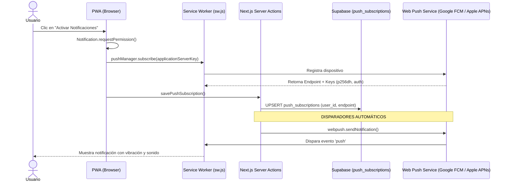

# 08. Progressive Web App (PWA) y Notificaciones Web Push

Documentación técnica del soporte PWA standalone, Service Worker y entrega de notificaciones Web Push firmadas con VAPID.

---

## 1. Arquitectura PWA Mobile-First

1. **Manifest Standalone (`public/manifest.json`)**:
   - `display: standalone`: Oculta la barra de navegación del navegador (Safari / Chrome), ejecutando la aplicación a pantalla completa como una app nativa.
   - `theme_color: #059669`: Tinte de barra de estado móvil.
   - Iconos PWA: Generados en 192x192 y 512x512 maskable en `public/icons/`.
2. **Instalación Ergonómica**:
   - Componente [`PwaPrompt.tsx`](../../src/components/PwaPrompt.tsx):
     - **En Android / Chrome**: Captura el evento `beforeinstallprompt` y presenta un botón *"Instalar App"*.
     - **En iOS Safari**: Detecta el dispositivo e instruye al usuario a usar *"Compartir" -> "Agregar a Inicio"*.

---

## 2. Web Push Notifications (VAPID) y Vinculación a Nivel de Cuenta

La plataforma utiliza el estándar **Web Push W3C** firmado criptográficamente con claves VAPID (Voluntary Application Server Identification), permitiendo enviar notificaciones push en segundo plano sin depender de tiendas de aplicaciones (App Store / Google Play).

### Desacople entre Permiso del Navegador y Cuenta de Usuario
Un error común en PWAs compartidas o al probar múltiples perfiles en un mismo dispositivo es asumir que si `Notification.permission === 'granted'`, el usuario actual ya está suscrito. 
- `Notification.permission` es una propiedad **del dispositivo/origen**, no de la cuenta.
- Si el usuario A activó notificaciones y luego el usuario B inicia sesión en ese mismo teléfono, la app validaba incorrectamente que las notificaciones estaban listas, impidiendo que el usuario B guardara su suscripción en la base de datos.

### Solución Implementada ([`AppOnboardingModal.tsx`](../../src/components/AppOnboardingModal.tsx)):
1. **Comprobación en Servidor**: El servidor consulta la tabla `push_subscriptions` filtrando por `user_id = user.id` (`hasPushSub`).
2. **Auto-Sincronización Silenciosa**: Si el navegador ya tiene permisos (`permission === 'granted'`) pero la cuenta no registra suscripción en la BD, la aplicación registra el endpoint del dispositivo y lo asocia automáticamente a la cuenta activa en segundo plano.
3. **Botón Dinámico de Vinculación**: Si se requiere acción manual, el botón cambia a *"Vincular Notificaciones a mi Cuenta"*.
4. **Caché de Descarte Scoped**: El descarte del modal se guarda en `localStorage` con la clave `campapp_onboarding_dismissed_${userId}`, asegurando que cada nuevo jugador que ingrese al dispositivo reciba su respectivo onboarding y recordatorio para completar sus datos.

---

## 3. Disparadores Automáticos Implementados

1. **Auto-Promoción de Lista de Espera**:
   - Al liberarse un cupo y ascender el primer socio en espera, se despacha:
     - **Título**: *¡Subiste de Lista de Espera! 🎉*
     - **Mensaje**: *Se liberó un cupo en el partido y quedaste confirmado automáticamente.*
2. **Aprobación de Invitados**:
   - Al aprobar un administrador a un invitado externo:
     - **Título**: *¡Invitado Aprobado! ✅*
     - **Mensaje**: *Tu invitado [Nombre] fue aprobado y confirmado para el partido.*
3. **Apertura de Votación MVP**:
   - Al finalizar el encuentro:
     - **Título**: *¡Vota al MVP del Partido! 🏆*
     - **Mensaje**: *El partido finalizó. Tienes 24hs para elegir a la figura del encuentro.*
4. **Depuración Automática de Suscripciones**:
   - Si un dispositivo desinstala la app o revoca permisos (código HTTP 404/410), el servidor elimina automáticamente el registro de `push_subscriptions`.
