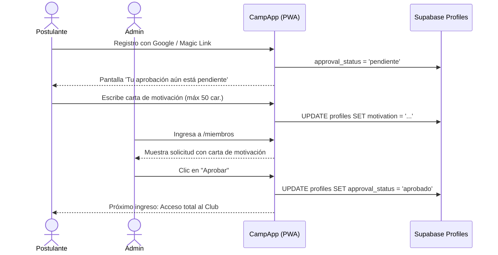

# 09. Admisión de Miembros, Directorio y Gestión de Roles

Documentación técnica del directorio de socios, perfil deportivo individual, control de admisión con cartas de motivación y administración de roles.

---

## 1. Directorio de Miembros del Club ([`/miembros`](../../src/app/miembros/page.tsx))

El directorio reúne la plantilla activa del club deportivo, optimizado para consulta rápida desde smartphones:

- **Buscador Reactivo**: Filtrado instantáneo por nombre o apodo.
- **Filtro por Posición / Rol Deportivo**: Pestañas de acceso directo para *Arqueros*, *Defensores*, *Mediocampistas* y *Delanteros*.
- **Insignias de Jerarquía**: Distintivo visual en negro y esmeralda para socios con privilegio de `Admin`.
- **Ficha Modal de Socio**: Al pulsar sobre cualquier miembro, se despliega una ficha con sus datos:
  - Avatar optimizado.
  - Rol en el club (`jugador`, `hincha`, `ambos`).
  - Posición habitual y dorsal preferido (extraído de `custom_attributes` JSONB).
  - Edad calculada a partir de su fecha de nacimiento (`birth_date`).
  - **Métricas Deportivas Acumuladas** (desde `user_stats`): Partidos jugados, MVPs ganados, votos recibidos y eventos sociales asistidos.

---

## 2. Cola de Admisión y Moderación con Carta de Motivación

Cuando un nuevo usuario inicia sesión por primera vez con su correo o cuenta de Google:
1. Su registro se crea en estado `approval_status = 'pendiente'`.
2. En la pantalla de espera, el postulante redacta una **carta de motivación breve** (máximo 50 caracteres) explicando su interés en unirse.
3. En el panel superior de `/miembros`, los administradores del club ven un contenedor destacado:
   - **Nombre y correo del postulante**.
   - **Cita textual de su carta de motivación**: *&ldquo;Juego de central, amigo de Seba con ganas de sumar.&rdquo;*
   - Botón **"Aprobar"** (`approveMemberAction`): Actualiza su estado a `aprobado`, habilitando instantáneamente su acceso a la app, barra de navegación y convocatorias.
   - Botón **"Rechazar"** (`rejectMemberAction`): Cambia su estado a `rechazado`.

---

## 3. Asignación de Roles de Sistema (Admin / Member)

Para evitar la necesidad de ingresar a la consola de base de datos de Supabase para promover administradores:
- Dentro de la ficha modal de cada socio en `/miembros`, los administradores disponen de una sección exclusiva: **"Gestión de Miembro (Admin)"**.
- **Cambio de Rol en Vivo**:
  - Un administrador puede promover a un socio a `admin` o degradarlo a `member` mediante [`updateMemberRoleAction`](../../src/app/miembros/actions.ts).
  - Incluye salvaguarda de seguridad para evitar que un administrador se degrade a sí mismo por error.
- **Eliminación de Miembro**:
  - Botón destructivo con confirmación para expulsar o eliminar un perfil del directorio (`deleteMemberAction`).

---

## 4. Acceso al Repositorio de GitHub

Para mantener la estética limpia y enfocada en los socios deportivos:
- Ninguna pestaña operativa (`/eventos`, `/miembros`, `/finanzas`, `/perfil`) expone enlaces técnicos o de arquitectura.
- En el pie de página de la pantalla principal (`/`), se incluye un botón discreto: **"Colaborar en GitHub"**, accesible únicamente para desarrolladores o miembros del club que deseen proponer ideas o contribuir con código fuente.
