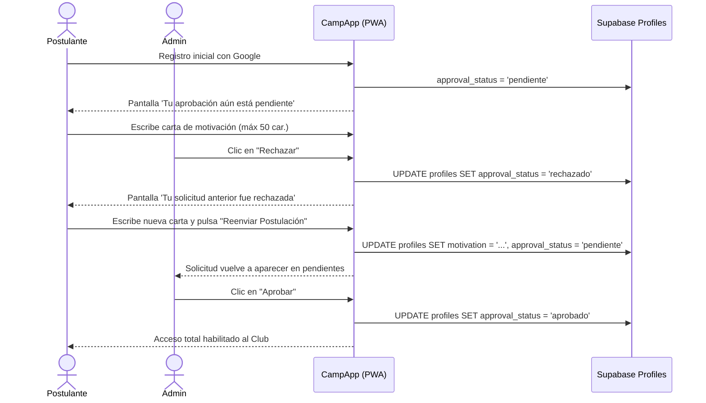

# 09. Admisión de Miembros, Directorio y Gestión de Roles

Documentación técnica del directorio de socios, perfil deportivo individual, control de admisión con cartas de motivación y administración de roles.

---

## 1. Directorio de Miembros del Club ([`/miembros`](../../src/app/miembros/page.tsx))

El directorio reúne la plantilla activa del club deportivo, optimizado para consulta rápida desde smartphones:

- **Buscador Reactivo**: Filtrado instantáneo por nombre o correo electrónico.
- **Selector de Posición Deportivo (Combo Box Táctil)**: Control dropdown accesible con icono de filtro que reemplaza las antiguas barras horizontales de botones, permitiendo filtrar limpiamente por *Todas las posiciones*, *Arquero*, *Defensor*, *Mediocampista* o *Delantero*.
- **Enfoque Exclusivo en Jugadores**: Toda la comunidad se conforma por jugadores activos (se eliminó la antigua distinción entre *jugador, hincha o ambos*). La identidad deportiva se rige por su posición en cancha (`posicion` en `custom_attributes`) y su categoría (`gender`).
- **Insignias de Jerarquía**: Distintivo visual en negro y blanco/esmeralda para socios con privilegio de `Admin`.
- **Ficha Modal de Socio**: Al pulsar sobre cualquier miembro, se despliega una ficha táctil con sus datos:
  - Avatar optimizado enmarcado en 2px con iniciales de respaldo.
  - Posición en cancha (`Delantero`, `Mediocampista`, `Defensor`, `Arquero` o `Jugador` por defecto).
  - Género configurado (`masculino`, `femenino`, `otro`) y dorsal preferido.
  - Edad calculada a partir de su fecha de nacimiento (`birth_date`, mayor a 18 años).
  - **Métricas Deportivas y Comunitarias Acumuladas** (desde `user_stats`):
    - **MVPs** (icono `<Trophy />`): Premios al mejor jugador del partido.
    - **Partidos** (icono `<Calendar />`): Presencias confirmadas en partidos oficiales y torneos.
    - **Votos** (icono `<Sparkles />`): Votos totales recibidos históricamente en encuestas MVP.
    - **Juntadas** (icono `<Flame />`): Asistencias confirmadas a asados, tercer tiempo, entrenamientos y reuniones del club.

---

## 2. Cola de Admisión, Moderación y Reconsideración (Sin Blacklist)

Cuando un nuevo usuario inicia sesión por primera vez con su cuenta de Google:
1. Su registro se crea en estado `approval_status = 'pendiente'`.
2. En la pantalla de espera, el postulante redacta una **carta de motivación breve** (máximo 50 caracteres) explicando su interés en unirse.
3. En el panel superior de `/miembros`, los administradores del club ven un contenedor destacado:
   - **Nombre y correo del postulante**.
   - **Cita textual de su carta de motivación**: *&ldquo;Juego de central, amigo de Seba con ganas de sumar.&rdquo;*
   - Botón **"Aprobar"** (`approveMemberAction`): Actualiza su estado a `aprobado`, habilitando instantáneamente su acceso a la app, barra de navegación y convocatorias.
   - Botón **"Rechazar"** (`rejectMemberAction`): Cambia su estado a `rechazado`.

### Prevención de Bloqueo Permanente (Re-postulación y Reconsideración)
Anteriormente, al ser rechazado, el socio quedaba invisible en el panel de administración sin posibilidad de volver a solicitar acceso. Para evitar este problema de "blacklist":
- **Re-postulación del Socio**: En [`PendingApprovalScreen.tsx`](../../src/components/PendingApprovalScreen.tsx), si el estado es `rechazado`, se despliega un mensaje explicativo (*"Tu solicitud anterior fue rechazada"*) y un formulario para enviar una nueva carta de motivación mediante el botón **"Reenviar Postulación al Club"**. La acción [`submitMotivationAction`](../../src/app/miembros/actions.ts) actualiza la motivación y **restaura automáticamente su estado a `pendiente`**.
- **Panel Administrativo de Postulaciones Rechazadas**: En `/miembros`, los administradores disponen de una sección desplegable dedicada para revisar a todos los miembros rechazados, con tres acciones directas:
  1. **"Reconsiderar"** (`reconsiderMemberAction`): Regresa al socio a la lista de pendientes para una nueva evaluación.
  2. **"Aprobar"** (`approveMemberAction`): Habilita su ingreso inmediato al club.
  3. **"Eliminar"** (`deleteMemberAction`): Elimina de manera definitiva su registro si es un caso no deseado.

---

## 3. Asignación de Roles de Sistema (Admin / Member)

Para evitar la necesidad de ingresar a la consola de base de datos de Supabase para promover administradores:
- Dentro de la ficha modal de cada socio en `/miembros`, los administradores disponen de una sección exclusiva: **"Gestión de Miembro (Admin)"**.
- **Cambio de Rol en Vivo**:
  - Un administrador puede promover a un socio a `admin` o degradarlo a `member` mediante [`updateMemberRoleAction`](../../src/app/miembros/actions.ts).
  - Incluye salvaguarda de seguridad para evitar que un administrador se degrade a sí mismo por error.
- **Eliminación de Miembro**:
  - Botón destructivo con confirmación para expulsar o eliminar un perfil del directorio (`deleteMemberAction`).

---

## 4. Acceso al Repositorio de GitHub

Para mantener la estética limpia y enfocada en los socios deportivos:
- Ninguna pestaña operativa (`/eventos`, `/miembros`, `/finanzas`, `/perfil`) expone enlaces técnicos o de arquitectura.
- En el pie de página de la pantalla principal (`/`), se incluye un botón discreto: **"Colaborar en GitHub"**, accesible únicamente para desarrolladores o miembros del club que deseen proponer ideas o contribuir con código fuente.
