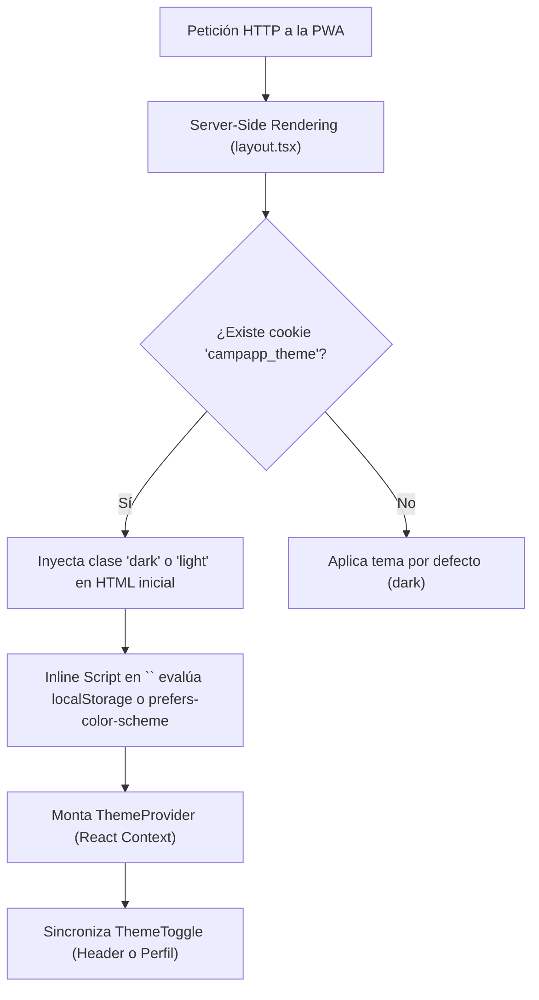

# 11. Sistema de Diseño Táctil y UX Mobile-First (Athletic Clubhouse)

CampApp implementa un sistema de diseño propio denominado **Athletic Clubhouse**, concebido para romper radicalmente con la estética genérica de aplicaciones creadas por IA (fondos oscuros homogéneos, tarjetas flotantes con sombras difusas desmedidas, gradientes morados y formularios sin carácter).

El sistema fusiona la estética física de los vestuarios, dorsales y credenciales de clubes deportivos con el **Neo-Brutalismo Táctil**, optimizado rigurosamente bajo las pautas de **Apple Human Interface Guidelines (HIG)** y **Google Material Design 3**.

---

## 1. Principios del Sistema "Athletic Clubhouse"

```mermaid
graph TD
    A["Athletic Clubhouse Design System"] --> B["Neo-Brutalismo Táctil"]
    A --> C["Tipografía Triádica (Auditada Impeccable)"]
    A --> D["Metáforas Físicas"]
    A --> E["Multi-Tenancy Cromático"]
    A --> F["Dual-Theme Atlético (Light & Dark Mode)"]

    B --> B1["Bordes sólidos de 2px (#171717 / #374151)"]
    B --> B2["Sombras físicas sin blur (3px 3px 0px)"]
    B --> B3["Micro-interacciones con desplazamiento real"]

    C --> C1["Display: Barlow Condensed (Titulares 700)"]
    C --> C2["Sans: Plus Jakarta Sans (Lectura)"]
    C --> C3["Mono: JetBrains Mono (Finanzas, Dorsales)"]

    D --> D1["Pase Provisional / Credencial de Admisión"]
    D --> D2["Acta de Liquidación de Partido"]
    D --> D3["Marcador Scoreboard de Carga"]

    E --> E1["10 Paletas Oficiales Dinámicas"]
    E --> E2["Inyección runtime por variables CSS"]

    F --> F1["Dark Mode sin parpadeo (Anti-flash SSR + Cookie)"]
    F --> F2["Fondos Oled/Slate con color-mix dinámico"]
```



1. **Light & Dark Mode Atlético de Alto Contraste**:
   - **Light Mode**: Fondo principal en gris hueso/cancha (`bg-neutral-50`), garantizando legibilidad total bajo luz solar directa en campos de juego y complejos deportivos.
   - **Dark Mode**: Fondo atlético carbón/noche (`bg-[#090a0f]`), tarjetas sólidas en `#14161f` con bordes `#374151`, sombras físicas negras netas (`--tactile-shadow-color: #000000`) y tintes oscuros automáticos para las 10 paletas mediante CSS `color-mix`.
   - Contenedor móvil enmarcado (`max-w-md mx-auto min-h-screen relative flex flex-col shadow-2xl`).

2. **Sensación Física y Masa**:
   - Cada botón, selector, tarjeta o modal transmite peso y textura física mediante bordes sólidos de 2px (`border-2 border-neutral-900 dark:border-neutral-700`) y sombras de desplazamiento neto sin difuminado (`shadow-tactile`).
   - Al pulsar un botón táctil (`.btn-tactile`), el elemento se traslada físicamente 2 píxeles (`active:translate-x-[2px] active:translate-y-[2px] active:shadow-none`), emulando la pulsación de un botón mecánico.

---

## 2. Sistema Tipográfico Triádico (Calibración Impeccable)

La tipografía refuerza la identidad deportiva y la claridad funcional mediante tres familias de fuentes con responsabilidades diferenciadas y una estricta jerarquía de pesos basada en las directrices de diseño **Impeccable**:

| Familia Tipográfica | Variable CSS / Clase | Aplicación | Justificación de Diseño |
| :--- | :--- | :--- | :--- |
| **Barlow Condensed** (Google Font, 600 / 700 / 800) | `var(--font-display)` / `font-display` | Encabezados globales (`h1, h2, h3, h4, th`), insignias, botones y pestañas. | Estética deportiva atlética de póster y camisetas. Impacto visual inmediato y compacto. Se utiliza peso 700 (`font-bold`) en lugar de 900 (`font-black`) para preservar los contraespacios interiores de las letras. |
| **Plus Jakarta Sans** (Google Font, 400 / 500 / 600) | `var(--font-sans)` / `font-sans` | Textos de cuerpo, notas explicativas, subtítulos y descripciones. | Máxima legibilidad neutral en pantallas móviles de 390px a 430px. |
| **JetBrains Mono** (Google Font, 500 / 600 / 700) | `var(--font-mono)` / `font-mono` | Importes monetarios (`$`), dorsales deportivos, horas, contadores y códigos de club. | Espaciado tabular exacto que evita saltos visuales al actualizar saldos o conteos. |

### Regla de Tipografía Global en CSS (`globals.css`) y Tracking Positivo
Para garantizar que los títulos condensados en mayúsculas respiren y no colisionen sus glifos, se eliminó el tracking negativo previo y se fijó una separación limpia:

```css
h1, h2, h3, h4, th {
  font-family: var(--font-display), var(--font-sans), sans-serif;
  letter-spacing: 0.01em;
}
```

### Principios de Tipografía sin "Visual Slop" (Auditoría Impeccable)
1. **Jerarquía sin saturación de negritas**: Se eliminó el uso indiscriminado de `font-black` (peso 900) en micro-textos, inputs y etiquetas secundarias. Se estandarizó `font-bold` (700) para titulares principales y `font-semibold` (600) para insignias y botones.
2. **Mayúsculas con tracking abierto (`0.05em - 0.12em`)**: Todas las etiquetas en mayúsculas (`UPPERCASE`) utilizan clases como `tracking-wider` o `tracking-widest` para asegurar que las palabras cortas no se perciban como bloques compactos.
3. **Microtextos accesibles**: Las etiquetas de estadísticas de jugadores y badges usan un tamaño mínimo de `text-[10px]` con peso `font-semibold`, garantizando lectura cómoda a la intemperie.

---

## 3. Utilidades y Clases Táctiles Base

En `src/app/globals.css` se definen las utilidades estándar reutilizadas en todos los módulos:

```css
/* Botón Táctil Mecánico */
.btn-tactile {
  border: 2px solid #171717;
  box-shadow: 2px 2px 0px #171717;
  transition: transform 0.08s ease, box-shadow 0.08s ease;
}
.btn-tactile:active:not(:disabled) {
  transform: translate(2px, 2px);
  box-shadow: 0px 0px 0px #171717;
}

/* Campo de Entrada Táctil */
.input-tactile {
  border: 2px solid #d4d4d4;
  border-radius: 0.75rem;
  background-color: #ffffff;
  color: #171717;
  transition: border-color 0.1s ease, box-shadow 0.1s ease;
}
.input-tactile:focus {
  outline: none;
  border-color: #171717;
  box-shadow: 2px 2px 0px #171717;
}
```

---

## 4. Metáforas Visuales de Componentes Clave

### A. Pase Provisional de Club / Ficha de Acreditación ([`PendingApprovalScreen.tsx`](../../src/components/PendingApprovalScreen.tsx))
En lugar de una pantalla vacía o un modal con fondo oscuro:
- **Formato Ticket / Credencial**: Tarjeta blanca con recortes laterales (*ticket notches*), encabezado superior con código de expediente e insignia de estado (`PASE PROVISIONAL` o `PASE DENEGADO`).
- **Dossier del Postulante**: Avatar con marco de 2px, nombre destacado en `font-display`, fecha de postulación en monospace y estado de la carta de motivación.
- **Acciones Táctiles**: Si la postulación fue rechazada, el postulante dispone de un campo `.input-tactile` para reenviar su motivación y reingresar a la cola de evaluación sin bloqueos.

### B. Acta de Liquidación de Partido ([`EventFinancialClosure.tsx`](../../src/components/EventFinancialClosure.tsx))
- Representación visual de un **acta oficial de tesorería**:
  - Saldo total recaudado, gasto real de la cancha y balance resultante del partido.
  - Entradas numéricas monoespaciadas para desglose de costos.
  - Botón táctil de confirmación con advertencia de cierre financiero irrevocable.

### C. Ficha de Incorporación ([`JoinClubForm.tsx`](../../src/app/club/unirse/[slug]/JoinClubForm.tsx))
- Tarjeta de solicitud de ingreso oficial con logotipo del club convocante, información de membresía y campo de motivación enmarcado en el sistema táctil.

### D. Panel de Tesorería del Club ([`FinanzasAdminPanel.tsx`](../../src/components/FinanzasAdminPanel.tsx))
- **Tarjeta de Saldo**: Tarjeta deportiva negra con textura micro-perforada (`bg-mesh-pattern-white`), saldo disponible en gran formato display y botones táctiles de recarga y configuración.
- **Dossier de Deudores**: Acordeón interactivo con fichas de miembros en mora, detalle de deudas por evento y botón de condonación táctil.

### E. Marcador de Carga Scoreboard ([`loading.tsx`](../../src/app/loading.tsx))
- Reemplazo del spinner tradicional por una tarjeta de marcador deportivo con bordes físicos de 2px, sombra táctil y pulso atlético.

---

## 5. Personalización Dinámica Multi-Club (10 Paletas Oficiales)

Cada club deportivo cuenta con una identidad cromática única seleccionada por sus administradores desde `/finanzas` ([`PalettePicker.tsx`](../../src/components/PalettePicker.tsx)):

| ID Paleta | Nombre Oficial | Color Primario Hex | Gradiente Hero | Sensación / Deporte |
| :--- | :--- | :--- | :--- | :--- |
| `emerald` | Verde Cancha | `#059669` | `from-emerald-600 to-teal-800` | Césped tradicional, fútbol, rugby |
| `navy` | Azul Marino | `#0f172a` | `from-slate-900 to-indigo-950` | Club clásico tradicional |
| `royal` | Azul Real | `#1d4ed8` | `from-blue-700 to-sky-900` | Deportes náuticos, básquetbol |
| `crimson` | Rojo Carmesí | `#dc2626` | `from-red-600 to-rose-900` | Pasión, garra, velocidad |
| `wine` | Vino Tinto / Bordó | `#881337` | `from-rose-900 to-pink-950` | Elegancia, clubes centenarios |
| `amber` | Dorado / Ámbar | `#d97706` | `from-amber-600 to-yellow-800` | Campeonatos, sol, tenis |
| `orange` | Naranja Fuego | `#ea580c` | `from-orange-600 to-red-800` | Atletismo, dinamismo |
| `teal` | Turquesa / Teal | `#0d9488` | `from-teal-600 to-cyan-900` | Frescura, natación, pádel |
| `purple` | Púrpura / Violeta | `#7c3aed` | `from-violet-700 to-purple-950` | Innovación, clubes modernos |
| `carbon` | Negro Carbón | `#18181b` | `from-zinc-900 to-neutral-950` | Monocromático, minimalismo de élite |

Las variables CSS (`--club-primary`, `--club-primary-light`, `--club-gradient-from`, `--club-gradient-to`) son inyectadas en tiempo de ejecución por [`RootLayout`](../../src/app/layout.tsx), tiñendo los acentos clave sin alterar la consistencia de los marcos y sombras táctiles neutros.

---

## 6. Normas de Ergonomía Móvil y Accesibilidad

1. **Objetivos Táctiles (Touch Targets)**:
   - Todo botón, tab o elemento interactivo cuenta con dimensiones mínimas de **44×44px** (óptimo 48px), asegurando un fácil accionamiento con el pulgar en movimiento o al borde de la cancha.

2. **Prevención de Zoom Forzado en iOS Safari**:
   - Todo elemento `<input>`, `<select>` y `<textarea>` utiliza un tamaño tipográfico mínimo de `text-base` (16px), impidiendo que iOS realice zoom accidental al enfocar campos.

3. **Safe Areas de Pantalla**:
   - La barra de navegación inferior ([`BottomNav.tsx`](../../src/components/BottomNav.tsx)) utiliza `env(safe-area-inset-bottom)` para respetar la barra de inicio táctil de iOS y terminales Android.
   - El contenedor general utiliza el espaciador `.pb-nav` para evitar superposiciones con el contenido principal.

4. **Teclados Numéricos Especializados**:
   - En campos de importes de cancha, montos de transferencia, dorsales o RUT, se implementa `inputMode="numeric"` para desplegar inmediatamente el teclado de dígitos.

---

## 7. Arquitectura de Modo Oscuro Atlético (Dual-Theme)

CampApp cuenta con un motor de Modo Oscuro nativo sin dependencias externas pesadas, diseñado para eliminar por completo el parpadeo blanco inicial (*Flash of Unstyled Theme - FOUT*):



### Componentes de la Arquitectura
1. **Contexto Liviano ([`ThemeProvider.tsx`](../../src/components/ThemeProvider.tsx))**:
   - Controla 3 modos: `'light' | 'dark' | 'system'`.
   - Escucha dinámicamente eventos del sistema operativo (`window.matchMedia('(prefers-color-scheme: dark)')`).
   - Sincroniza la selección tanto en `localStorage` como en una cookie persistente `campapp_theme` (duración 1 año) para que el servidor Next.js renderice el HTML con la clase correcta antes de enviar el stream al cliente.
2. **Switch Atlético Dual ([`ThemeToggle.tsx`](../../src/components/ThemeToggle.tsx))**:
   - **Variante `icon`**: Botón compacto con iconos `<Sun />` y `<Moon />` ubicado en la cabecera del dashboard.
   - **Variante `segmented`**: Selector táctil de 3 segmentos (*Claro, Oscuro, Sistema*) integrado en la pantalla de `/perfil`.
3. **Tailwind CSS v4 `@custom-variant dark`**:
   - Configurado en `globals.css` mediante `@custom-variant dark (&:where(.dark, .dark *));`.
   - Permite aplicar variantes `dark:bg-[#14161f]`, `dark:border-neutral-700`, `dark:text-white` de manera predecible y sin conflictos con clases Tailwind v4 en TurboPack.

